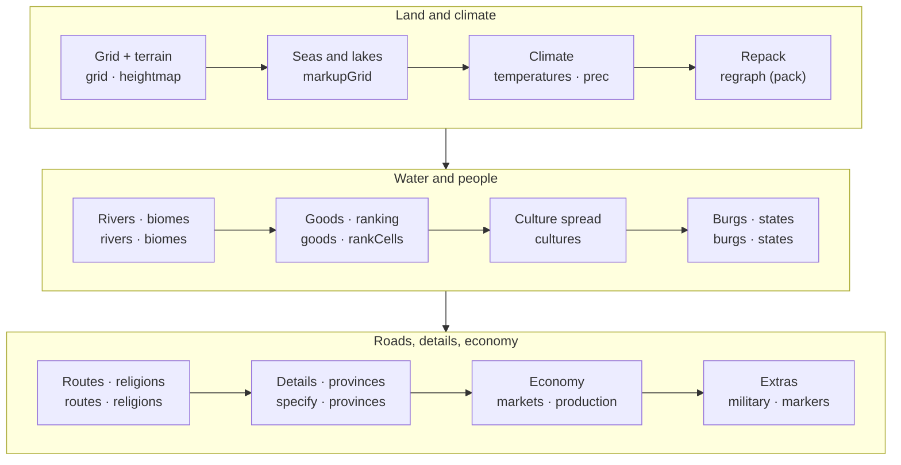
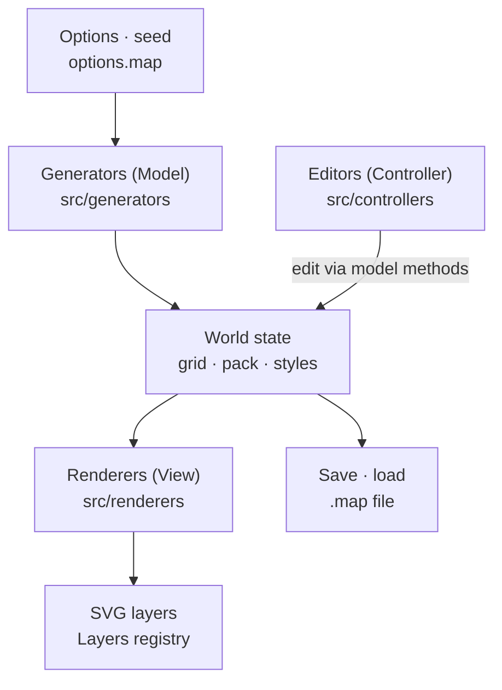

[](/static/images/fmg/hero.webp)

## 1. Why Fantasy Map Generator?

Fantasy writers and game masters always need maps, and drawing a good one is hard. A coastline is not enough. Mountain ranges, the direction rivers flow, where deserts and forests appear and which nations settle where all have to agree with each other before a world feels plausible.

[Fantasy Map Generator](https://github.com/Azgaar/Fantasy-Map-Generator) (FMG from here on) does this with one button. It started in March 2017, has 6,100 GitHub stars and 1,000 forks, and has received more than 60 commits in the last five weeks alone. This analysis covers v1.154.2, released on October 16.

What FMG produces is **a world made of data**. Every cell has a height, temperature, precipitation, biome, culture, religion, state and province. Every burg has a population and knows whether it has walls; every state has a form of government and diplomatic relations. The map is just that data drawn as SVG. That is why the same world can be viewed as a political, cultural or climate map, and why moving a river in the editor changes the data on top of it as well.

This post follows the code to see in what order, and with which algorithms, that world gets built.

## 2. In one sentence

**FMG** is a **browser-only world generator**: it uses seeded randomness to build a jittered grid, lays Voronoi cells over it, runs 40 generation steps in the order terrain → climate → water → people → economy, and draws the result as SVG layers.

| Question                 | FMG's answer                                                                                                                                |
| ------------------------ | ------------------------------------------------------------------------------------------------------------------------------------------- |
| Does it need a server?   | No. Generation, editing, rendering and saving all run in the browser. A desktop app wraps the same code in Electron.                        |
| What is the basic unit?  | A Voronoi cell. The default map has 10,000 of them.                                                                                         |
| How is terrain made?     | By running one of 14 templates, scripts of commands such as `Hill 1 90-100 44-56 40-60`.                                                    |
| How are borders decided? | A multi-source Dijkstra starting from the capitals. Terrain, biome, rivers and culture go into the cost function.                           |
| Same seed, same world?   | Yes. It replaces `Math.random` itself with a seeded PRNG (Alea).                                                                            |
| How is the result saved? | The whole world serializes into one `.map` file. Reopening it gives the identical map, and the project treats that promise as an invariant. |
| Licence?                 | MIT.                                                                                                                                        |

## 3. How it relates to earlier posts

| Post                                                                                       | Relation                                                                                                                                                                                                              |
| ------------------------------------------------------------------------------------------ | --------------------------------------------------------------------------------------------------------------------------------------------------------------------------------------------------------------------- |
| [HyperFrames](/kb/2026-10-07-hyperframes-architecture)                                     | Determinism is central to both. HyperFrames replaces the page's clock with a virtual one so the same input gives the same video; FMG replaces `Math.random` with a seeded PRNG so the same seed gives the same world. |
| [The bridge that runs Minecraft in Elden Ring](/kb/2026-10-07-minecraft-elden-ring-bridge) | Both treat a game world as data. The bridge merged the worlds of two existing games into one frame; FMG builds world data, from terrain to nations, on an empty canvas.                                               |

## 4. Stack and size

The project is in the middle of a move to TypeScript. Excluding tests, `src/` holds 384 TypeScript files, about 108,000 lines. The main folders:

| Folder             | Files |  Lines | Role                                                                          |
| ------------------ | ----: | -----: | ----------------------------------------------------------------------------- |
| `src/controllers/` |   113 | 45,544 | Editors, tools, dialogs, overviews, the AI assistant                          |
| `src/generators/`  |    48 | 22,865 | Procedural generation (terrain, climate, rivers, cultures, states, economy …) |
| `src/renderers/`   |    76 | 12,115 | Drawing world data into SVG layers                                            |
| `src/components/`  |    50 |  9,086 | App state (layers, options, zoom) and reusable UI                             |
| `src/services/`    |    35 |  8,453 | Save, load and export, PWA, auto-update                                       |
| `src/data/`        |    27 |  5,806 | Static data such as terrain templates, name bases, heraldry                   |
| `src/utils/`       |    24 |  3,460 | Pure helper functions                                                         |

There are 206 test files. The app shell and the map's SVG structure live in a single 44 KB `src/index.html`.

There are only nine runtime dependencies: `d3` (geometry, scales, quadtrees), `delaunator` (Delaunay triangulation), `alea` (seeded PRNG), `polylabel` (label placement), `lineclip`, `three` (3D view), `zod` (style schema), `quill` (notes editor) and `driver.js` (tour). Vite builds it and Biome lints it. There is no UI framework such as React; renderers assemble SVG strings and inject them in one write.

## 5. Generating a map myself

Clone the repository, run `npm ci`, start the Vite dev server, and a map appears straight away. Add `?seed=` to the URL to pick the seed.

My first try was seed `20261019`. The northern half of the map came out frozen white.

[](/static/images/fmg/first-polar.webp)

The options explain it. For this seed the map size (`mapSize`) came out at 100%, which means a single map covers the whole planet from 90°N to 90°S. The top rows are polar, temperatures drop below zero, and any cell colder than −5 °C becomes glacier straight away in the biome table. Only 17 rivers formed, because the precipitation pass skips permafrost cells below −5 °C, so almost no rain falls on the northern land. The climate model did exactly what those latitudes call for.

After trying a few seeds I settled on `2026`. This seed rolled the Archipelago terrain template and a map size of 58%. In latitude that is 104.4°, from 62.8°N to 41.6°S, so the equator runs through the map. Every screenshot after this point comes from this map.

| Item            | Value                                                                                                                 |
| --------------- | --------------------------------------------------------------------------------------------------------------------- |
| Cells           | 9,975 in the grid → 4,211 in the repacked graph (pack) (10,000 requested; fitting a square grid gives slightly fewer) |
| States          | 25 (5 kingdoms, 5 principalities, 4 duchies, 4 grand duchies, 3 empires, 2 republics, 1 theocracy, 1 dominion)        |
| Burgs           | 493                                                                                                                   |
| Cultures        | 10 (5 generic, 2 naval, 2 river, 1 lake)                                                                              |
| Religions       | 16 (10 folk, 3 organized, 2 cults, 1 heresy)                                                                          |
| Provinces       | 179                                                                                                                   |
| Rivers          | 195                                                                                                                   |
| Routes          | 407 (21 roads, 262 trails, 124 sea routes)                                                                            |
| Markets         | 19                                                                                                                    |
| Generation time | 216 ms for the pipeline (median of 3 runs)                                                                            |

Switching layers on the same map shows how the world is stacked. From the top left: height, temperature, biomes, cultures, states and provinces.

| Height                                                                                                                                                                                                                               | Temperature                                                                                                                                                                                                                             |
| ------------------------------------------------------------------------------------------------------------------------------------------------------------------------------------------------------------------------------------ | --------------------------------------------------------------------------------------------------------------------------------------------------------------------------------------------------------------------------------------- |
| [](/static/images/fmg/heightmap.webp)                                                 | [](/static/images/fmg/temperature.webp) |
| **Biomes**                                                                                                                                                                                                                           | **Cultures**                                                                                                                                                                                                                            |
| [](/static/images/fmg/biomes.webp) | [](/static/images/fmg/cultures.webp)                                     |
| **States**                                                                                                                                                                                                                           | **Provinces**                                                                                                                                                                                                                           |
| [](/static/images/fmg/states.webp)                                                                      | [](/static/images/fmg/provinces.webp)                                                                                   |

Turn on the religion layer and it looks almost exactly like the culture map. Every culture gets one folk religion, and folk religions copy the culture's territory as is. Only the three organized religions and two cults spread separately on top.

Zooming in shows cell-level detail. Borders bend along ridges, roads go around lakes, and burg names are placed so they don't collide.

[](/static/images/fmg/detail-zoom.webp)

Changing the style preset turns the same data into a completely different map. Style is part of the world data too, so it is saved in the `.map` file.

[](/static/images/fmg/styles.webp)

## 6. The big picture: a 40-step generation pipeline

The generation order is declared as a list of steps in `src/generators/generation-pipeline.ts`. It used to be a hard-coded sequence of calls inside `generate()`; now it is an array of 40 `{ id, run }` objects.

```ts
const generationPipelineSteps = [
  { id: 'grid', run: ({ graph }) => Grid.prepare(graph) },
  { id: 'heightmap', run: () => HeightmapGenerator.generate() },
  { id: 'markupGrid', run: () => Features.markupGrid() },
  // ... 35 more
  { id: 'addedLabels', run: () => AddedLabels.initiate() },
  { id: 'journeys', run: () => Journeys.generate() },
] as const satisfies PipelineStep<string, GenerationContext>[]
```

The runner (`pipeline.ts`) just executes the array from front to back and never reorders it. It records a `performance.measure` per step, and when a step throws it reports where, as in `Generation Pipeline failed at step "rivers": ...`.

There is no dependency graph. According to the docs, steps once carried a `dependsOn` list, but it always named the step right before. The real sequence has only ever been a straight line, so the list added validation code without doing any work, and it was removed. Generators pass data to each other through the global `grid` and `pack` objects, so **the execution order is the dependency graph**.



The bars below show how long each step took while generating the seed 2026 map. Click a phase to see what it does and what it produced.

<FmgPipeline lang="en" />

On the 10,000-point map the slowest step was neither terrain nor nations but the economy's `production`: 65.5 ms, 30% of the 216 ms pipeline. Second was `routes` (31.6 ms), which lays the road network.

I then measured the same seed with different point counts. A different point count gives a different grid, so the map's shape changes too. Burgs actually get fewer, because the formula for the automatic burg count divides the number of populated cells by `(points / 10,000)^0.8`.

|  Points | Pack cells | Burgs | Pipeline | `grid` | `rivers` | `routes` | `production` |
| ------: | ---------: | ----: | -------: | -----: | -------: | -------: | -----------: |
|  10,000 |      4,211 |   493 |   216 ms |   15.1 |     11.6 |     31.6 |         65.5 |
|  30,000 |      8,158 |   418 |   358 ms |   34.3 |     45.5 |     50.6 |         66.2 |
| 100,000 |     18,944 |   379 |   755 ms |   93.5 |     77.6 |    157.3 |         71.5 |

Ten times the points made the whole pipeline 3.5× slower, yet `production` barely moved. The production simulation scales with burgs and markets, not cells. Steps that walk the cell graph, such as the grid, rivers and routes, grow with the cell count instead, and at 100,000 points `routes` becomes the slowest step.

## 7. Try a mini FMG first

Below is a re-implementation of FMG's early steps for this blog, scaled down to about 1,400 cells. It computes the jittered grid, the Voronoi cells, terrain template commands, depression filling and water flow, and the Dijkstra spread from capitals the same way FMG does. Change the seed and the world changes; go back to a seed and the same world returns. In the last stage you can replay the order in which borders get decided.

<FmgWorldBuilder lang="en" />

Now for each stage in the real code.

## 8. Two graphs: grid and pack

### 8.1 A jittered square grid

FMG cells do not start from random points. It first lays a square grid with spacing `spacing = √(W·H / cells)` for the requested cell count, then shakes each point inside its own square by up to 90% of the half-spacing.

```ts
private getJitteredPoints(width: number, height: number, spacing: number): Point[] {
  const radius = spacing / 2;
  const jittering = radius * 0.9;
  const doubleJittering = jittering * 2;
  const jitter = () => Math.random() * doubleJittering - jittering;
  // centre of each square + jitter()
}
```

Purely random points clump and leave gaps, so cell sizes vary wildly. A jittered grid keeps cell sizes even while the shapes still look natural. As a bonus, `findCell(x, y)` takes two divisions, because no point ever leaves its square. What it returns is the square the coordinate falls in, so near a cell border it is an approximation that can differ from the cell of the truly nearest point.

`delaunator` triangulates these points, and the circumcentre of each triangle becomes a Voronoi vertex (`voronoi.ts`). A ring of boundary points outside the map, which own no cells, clips the outer cells so they don't stretch to infinity.

### 8.2 Repacking cells where they matter

Once terrain and climate are set, the `regraph` step builds a second Voronoi graph, `pack`. Deep ocean points are dropped, and an extra midpoint goes between neighbouring coastal cells.

```ts
if (height < SEA_LEVEL && type !== -1 && type !== -2) continue; // drop deep ocean
...
if (type === 1 || type === -1) {            // coastal cell
  for (const e of gridCells.c[i]) {
    if (gridCells.t[e] !== type) continue;
    if (dist2 < spacing2) continue;
    addNewPoint(i, (x + points[e][0]) / 2, (y + points[e][1]) / 2, height);
  }
}
```

On the seed 2026 map, 9,975 grid cells became 4,211 pack cells. Open ocean where nobody lives needs no resolution, while a coastline looks better the finer it is. Everything that follows, rivers, cultures and states included, is computed on pack cells. The docs warn that this step "invalidates every earlier pack cell index".

[](/static/images/fmg/cells-zoom.webp)

### 8.3 Arrays instead of cell objects

Cell data is not an array of objects but a bundle of typed arrays of equal length. `pack.cells.h` is a `Uint8Array`, so is `cells.biome`, and `cells.pop` is a `Float32Array`. Cell `i`'s height is `cells.h[i]` and its biome `cells.biome[i]`. Even a 100,000-cell map stays light on memory and fast to loop over. The architecture docs call this structure-of-arrays and make it a hard rule.

## 9. Terrain: heights from a template language

Terrain comes from **command scripts**, not noise functions. Fourteen templates live in `src/data/heightmap-templates.ts`, one command per line, in the form `tool count height x-range(%) y-range(%)`.

```text
Hill 1 80-85 60-80 40-60        ← one hill of height 80–85, right of centre
Hill 1 80-85 20-30 40-60        ← and one on the left
Hill 6-7 15-30 25-75 15-85      ← 6–7 low hills scattered around
Multiply 0.6 land 0 0           ← scale land heights by 0.6
Range 1-2 30-60 5-15 25-75      ← 1–2 mountain ranges
Strait 2 vertical 0 0           ← a vertical strait
Smooth 3 0 0 0                  ← average with neighbours
Pit 3-4 10-20 15-85 20-80       ← depressions
Mask 4 0 0 0                    ← push the edges into the sea
```

That script is the Continents template. Each template has a pick weight, so High Island (19), Archipelago (18) and Continents (16) come up most often.

Each command is simple. `Hill` gives a height to a start cell and spreads it to neighbours by BFS, a little lower each ring.

```ts
change[start] = h
const queue = [start]
while (queue.length) {
  const q = queue.shift()
  for (const c of this.grid.cells.c[q]) {
    if (change[c]) continue
    change[c] = change[q] ** this.blobPower * (Math.random() * 0.2 + 0.9)
    if (change[c] > 1) queue.push(c)
  }
}
```

`blobPower` is an exponent just under 1. Height 90 raised to 0.98 is about 82, and the value keeps shrinking as it passes outward. The more cells, the closer `blobPower` sits to 1 (0.93 for 1,000 cells, 0.98 for 10,000, 0.9973 for 100,000), so a hill keeps the same real size however dense the cells are. The random 0.9–1.1 factor at each step makes the hill's edge ragged.

`Range` walks from a start cell to an end cell, always stepping to the neighbour closest to the end, which forms a ridge. Each neighbour has a 15% chance of having its distance counted as half, so the ridge wanders instead of running straight. `Mask` multiplies by `(1 - nx²)(1 - ny²)` to pull the edges of the map down into the sea.

## 10. Climate: latitude and wind

### 10.1 Temperature

Temperature is set per row from latitude and then reduced per cell by altitude.

```ts
const getAltitudeDrop = (height: number) => {
  if (height < SEA_LEVEL) return 0
  return rn(((height - 18) ** exponent / 1000) * 6.5)
}
```

It uses the real lapse rate of 6.5 °C per kilometre. The equator and pole temperatures are options, and inside the tropics (16°N to 20°S) a gentler gradient applies. That is why the temperature layer looks like horizontal bands, with isotherms bending only around mountains.

### 10.2 Precipitation

The first comment in `precipitation-generator.ts` calls it "the simplest precipitation model". Each 30° latitude tier has a wind direction set in the options (trade winds, westerlies, polar easterlies). Winds enter from the rows or columns at the map edge and cross the cells one by one.

- Crossing sea, the wind picks up moisture.
- Over land it drops part of its moisture as rain, more when the next cell is higher (orographic rain).
- Cells above height 85 can't be crossed. The wind dumps everything in front of them and dries out. That is how the rain shadow behind a mountain range appears.
- Every 5° latitude band has a factor (×4 at the equator, ×1 in the subtropical high at 20–30°, ×3 at 50–60°), mimicking the rising and sinking zones of the real atmospheric circulation.

[](/static/images/fmg/precipitation.webp)

## 11. Water: fill the pits, then let it flow

### 11.1 Filling depressions

To make water run downhill, the pits (depressions) that would trap it have to go first. `resolveDepressions` walks the cells from lowest up and raises any cell that is no higher than its neighbours to 0.1 above the lowest one. It repeats until no depressions remain (up to 250 passes by default). Lakes have their surface raised by 0.2 at a time. When the passes drag on, a lake is settled as a closed lake that drains nowhere.

If the count of depressions stops falling after several passes, it restores the original heights and gives up.

### 11.2 Draining

`drainWater` sweeps the land cells once, **highest first**.

```ts
const land = cells.i.filter(i => h[i] >= 20).sort((a, b) => h[b] - h[a]);
for (const i of land) {
  cells.fl[i] += prec[cells.g[i]] / cellsNumberModifier; // add the rain
  ...
  const min = cells.c[i].reduce((m, c) => (h[c] < h[m] ? c : m)); // to the lowest neighbour
  if (cells.fl[i] < MIN_FLUX_TO_FORM_RIVER) { cells.fl[min] += cells.fl[i]; continue; }
  if (!cells.r[i]) cells.r[i] = riverNext++; // enough water: a new river
  flowDown(min, cells.fl[i], cells.r[i]);
}
```

Because the highest cells go first, by the time a cell is reached all the water from upstream has already arrived. One sort and one pass compute the flow of every basin. Where two rivers meet, the one carrying more water stays the main stem and the other is recorded as a tributary. Then `downcutRivers` cuts high-flow riverbeds down by up to 5 to carve valleys.

### 11.3 One table picks the biome

The biome comes from a table of 26 temperature columns by 5 moisture rows. Moisture is precipitation plus river flow. Three exceptions are checked before the table: below −5 °C is glacier, 25 °C or hotter with no river and little moisture is hot desert, and very wet lowland is wetland.

```ts
if (temperature < -5) return 11 // Glacier
if (temperature >= 25 && !hasRiver && moisture < 8) return 1 // Hot desert
if (this.isWetland(moisture, temperature, height)) return 12 // Wetland
const moistureBand = Math.min((moisture / 5) | 0, 4) // 0–4
const temperatureBand = Math.min(Math.max(20 - temperature, 0), 25) // 0–25
return biomesMatrix[moistureBand][temperatureBand]
```

Each biome carries a **habitability** and a movement **cost**. Temperate deciduous forest has habitability 100 and cost 70; glacier has habitability 0 and cost 5,000. These two numbers decide, in the next steps, where people live and how far nations spread.

## 12. People: score the cells, then spread with Dijkstra

### 12.1 Scoring how liveable a cell is

`rankCells` gives every land cell a score `s`.

```ts
let score = biomes[cells.biome[i]].habitability // start from biome habitability
if (meanFlux) score += normalize(cells.fl[i] + cells.conf[i], meanFlux, maxFlux) * 250 // big rivers, confluences
score -= (cells.h[i] - 50) / 5 // higher is worse
// on the coast: estuary +15, sea +5, safe harbour +20, freshwater lake +30 …
```

The value of goods on the cell and around it is added, and rural population `pop` scales with the cell's area. This score then decides where culture centres, capitals and towns go.

### 12.2 Cultures: cheapest cell first

Culture centres go on high-scoring cells, kept a minimum distance apart. The centre's surroundings set the culture type: low desert or grassland makes it Nomadic, height above 50 Highland, a good harbour Naval, a big river River.

The spread is a Dijkstra that starts from every centre at once. The priority queue (`FlatQueue`) pops the cell with the lowest accumulated cost, adds the cost of stepping to each neighbour, and pushes them back. A cell goes to whichever culture reaches it cheapest.

```ts
const cellCost = (biomeCost + biomeChangeCost + heightCost + riverCost + typeCost) / expansionism
const totalCost = priority + cellCost
```

Culture type changes every term.

| Cost                | Default                           | Type exceptions                                                       |
| ------------------- | --------------------------------- | --------------------------------------------------------------------- |
| Biome               | Home biome 10, otherwise cost × 2 | Hunting cost × 5, Nomadic cost × 10 in forest                         |
| Crossing water      | cell area × 6                     | Naval area × 2, Nomadic area × 50, Lake cultures 10 on lakes          |
| Height              | mountains 200, hills 30           | Highland is reversed: low ground is expensive (3,000 below height 44) |
| River               | 20–100 depending on flow          | River cultures 0 on a river, 100 off it                               |
| Distance from coast | coastline 20                      | Naval and Lake 0 on the coastline, 100 deep inland                    |

Seafaring peoples stretching along coasts, highlanders staying in the mountains and nomads avoiding forests all come out of this table. None of those rules is written in the code.

### 12.3 States: same algorithm, different costs

Capitals are sorted by score times a random 0.5–1 factor and placed at least `(W+H)/2/number of states` apart. If they don't fit, the spacing is divided by 1.2 and it tries again. Each capital becomes one state.

Borders come from Dijkstra too.

```ts
const cultureCost = culture === cells.culture[e] ? -9 : 100;
const populationCost = cells.h[e] < 20 ? 0 : cells.s[e] ? Math.max(20 - cells.s[e], 0) : 5000;
...
const cellCost = Math.max(cultureCost + populationCost + biomeCost + heightCost + riverCost + typeCost, 0);
const totalCost = p + 10 + cellCost / states[s].expansionism;
```

Two things differ from the culture spread. Entering a cell of the state's own culture costs 9 less, a foreign one 100 more, so borders tend to follow cultural boundaries. A cell nobody can live in costs 5,000, which is almost a wall. Mountains cost 2,200 and the sea 1,000 (300 for naval states), far more than for cultures. Each state divides the cost by its own `expansionism` (a random number of at least 1), so some nations grow large and others stay small.

After the spread comes one tidy-up pass. A cell surrounded by another state's cells switches to that state, so borders don't turn ragged.

The state's form is decided last. Its area relative to the median puts it in one of five tiers, and monarchies are named Duchy → Grand Duchy → Principality → Kingdom → Empire by tier. Name bases override this: Mongolian bases give a Khanate, Turkic a Khaganate, Arabic an Emirate. That is where "Baylian Khaganate" on the first map came from.

If the capital's religion spreads by state, the state becomes a Theocracy. A capital whose religion is organized or a cult also has a 10% chance of becoming one.

### 12.4 Religions and provinces

Religions follow the same pattern. Folk religions copy the culture's territory; organized religions and cults start from large burgs and spread with Dijkstra. A religion pays 1 to move along a road and the biome cost off-road, which is why organized religions spread along the road network. An organized religion with high expansionism spawns zero to three heresies along the edge of its territory.

Provinces pick centres per state, largest burgs first, and split the state with a Dijkstra that never crosses the border. The cost is height alone. Leftover land is grouped by flood fill and named Island, Territory and so on; if it has no land route to the capital, there is a 50% chance it becomes a "New ..." colony.

## 13. Roads and names

### 13.1 Roads follow an Urquhart graph

The road network does not connect every pair of burgs. It triangulates the burg positions with Delaunay and removes the longest edge of every triangle. That is the Urquhart graph, and the remaining edges link only near neighbours, which looks like a real road network.

For each edge, Dijkstra on the cell graph finds the actual path. The order is sea routes, then roads between capitals, then trails between all burgs. The cost is squared distance times height and habitability factors, and **segments that already carry a road cost half**.

```ts
const connectionModifier = this.connections.has(`${current}-${next}`) ? 0.5 : 1
const burgModifier = pack.cells.burg[next] ? 1 : 3
```

Later roads therefore join earlier ones and prefer to pass through cells with a burg. Burg populations are set only after all roads exist (`burgsSpecify`), and a burg with more routes through it gets its population multiplied by a connectivity factor. The pipeline order creates the causality that big towns grow where transport is good.

### 13.2 Names come from a syllable Markov chain

Names of burgs, states and rivers come from Markov chains trained on 43 name bases, one per language (`src/data/name-bases.ts`). Real place names are cut into syllables of up to five letters at vowel–consonant transitions, and a table maps "last letter of the previous syllable → next syllable".

Generation starts from the empty string, keeps appending a random syllable that fits the last letter, and stops when an end marker (a terminal token) comes up within the length range. That is how a chain trained on English place names produces "Grantford" and "Oakburgh".

## 14. Economy: heavy no matter the cell count

The economy is a separate simulation attached near the end of the pipeline. There are 71 goods, and each good's distribution rule is a string. The generator runs that string with `new Function` and evaluates it per cell with helpers such as `biome()`, `minHeight()` and `river()`.

On top of that, a single pass runs in this order.

1. **Markets**: burgs are weighted toward capitals and ports to pick market towns, and Dijkstra divides the market areas. Crossing into another state or over water costs extra.
2. **Production**: rural cells supply raw materials that suit their biome. Burgs, smallest first, look through recipes and make and sell whatever earns the most.
3. **Trade**: goods move between markets when the price gap beats transport cost and tax.
4. **Taxes**: transaction tax and poll tax flow into each state's treasury.

The seed 2026 map got 19 markets, and the `production` step of this simulation took 65.5 ms. As shown above, that time barely changes as the cell count grows.

## 15. Same seed, same world

FMG gets determinism the simple way. Before generating, it replaces `Math.random` itself with a seeded PRNG.

```ts
// src/components/seed.ts
Math.random = aleaPRNG(options.map.seed)
```

Generator code uses only `Math.random()` and helpers built on it, such as `rand`, `P`, `gauss` and `rw`. Even d3's normal distribution is pointed at the same source with `d3.randomNormal.source(() => Math.random())`.

There is one more layer. Many generators **reseed** when they start.

```ts
// precipitation-generator.ts
Math.random = Alea(options.map.seed) // the same winds for the same map, whoever rolled before
```

The grid, terrain, sea markup, precipitation, river, goods, route, province and market steps all do this. Their output stays the same no matter how many random numbers earlier steps used. That is why winds and goods stay put when you delete a mountain in the terrain editor and only the later steps rerun (`ErasePipeline`).

I checked it. I generated seed 2026, then a different map from seed 9999, then seed 2026 again, and hashed the full height, state, culture and biome arrays.

| Order           | Hash         | States | Burgs | First burg |
| --------------- | ------------ | -----: | ----: | ---------- |
| Seed 2026       | `3699448255` |     25 |   493 | Axblerid   |
| Seed 9999       | `4280839211` |     17 |   649 | Oxbrok     |
| Seed 2026 again | `3699448255` |     25 |   493 | Axblerid   |

With the same seed, the hashes of all four arrays matched exactly, regardless of what was generated before.

Options work the same way. Generation options such as the number of states, the template and temperatures are re-rolled from the seeded PRNG every time. Only values the user has locked with a Pin stay put. A single seed decides the whole world, options included.

## 16. Architecture: four layers and global state

### 16.1 State, generators, editors, renderers

FMG is moving toward a structure it calls "FMG 2.0". The architecture docs describe the target like this.



The rules are clear. Generators never touch the DOM or SVG. Renderers never change world state, and drawing the same state twice gives the same output. Editors change state and then ask the renderer to redraw. Even an edit such as renaming a state goes through a model method like `States.rename`. Editors and the AI assistant call the same methods, so every edit has exactly one implementation.

Import direction is fixed too. `controllers` may import anything, `renderers` only what sits below them up to `generators`, and `generators` only `utils`, `types` and `data`. A generator that wants to show a tooltip cannot import a UI module.

### 16.2 The layer registry

The map's 39 layers are declared as one ordered list in `src/components/layers.ts`. **Registration order is the z-order, the init order and the draw order.** It is the same idea as the generation pipeline: declare the order as data and never sort or compute dependencies.

Turning a layer off doesn't just hide its group; it drops the content. Thousands of hidden nodes still cost style recalculation and hit-testing. Every screenshot in this post was taken by switching layer combinations with `Layers.set([...])`.

### 16.3 Rendering rules

Many of the renderer rules are about performance.

- Assemble a layer as one string and inject it once; never append nodes in a loop.
- Use d3 only for geometry, scales and quadtrees, never `selectAll().data().enter().append()` to build DOM. The docs explain that data joins keep data and closures alive per element.
- Merge cells with the same value into a few large polygons instead of one path per cell.
- Define icons once in `<defs>` and stamp them with `<use>`.
- Round coordinates to keep path strings short.

Editor dialogs are built on open and destroyed on close. Every dialog used to sit in `index.html` and was only shown and hidden. Long lists with a row per state, culture or burg stayed in the DOM, and a long session could grow to gigabytes of memory. Now a call such as `Controllers.StatesEditor.open()` goes through a registry that dynamically imports the module on first use.

### 16.4 Global state, in practice

There is still distance between the target and the code. Generators read and write `window.grid`, `window.pack` and `window.options` directly. Generator modules such as `Grid`, `Rivers` and `States` register themselves on `window` as well, because remaining legacy scripts call them as globals. The project's own `CONTEXT.md` lists this as the sharpest edge and asks for extreme caution when turning globals into explicit parameters.

## 17. Suggested reading order

1. `CONTEXT.md`, `docs/architecture/architecture.md`: the target structure and the rules.
2. `docs/architecture/generation-pipeline.md`: a table of what each phase reads and writes.
3. `src/generators/generation-pipeline.ts`, `pipeline.ts`: the actual order and the runner. Both are short.
4. `src/generators/grid-generator.ts`, `voronoi.ts`, `pack-generator.ts`: how the two graphs are built.
5. `src/data/heightmap-templates.ts`, `heightmap-generator.ts`: the template language and its commands.
6. `temperature-generator.ts`, `precipitation-generator.ts`, `river-generator.ts`, `biomes-generator.ts`: climate and water.
7. `population-generator.ts`, `cultures-generator.ts`, `states-generator.ts`: scoring and Dijkstra spread. Read the cost functions side by side.
8. `routes-generator.ts`, `names-generator.ts`: the Urquhart graph and the Markov chain.
9. `src/components/layers.ts`, `src/renderers/`: how state becomes SVG.

## 18. Design choices worth noting

**1. Order is declared as data.** Generation steps and layers are each one ordered array. The docs even record the decision to remove `dependsOn` once it was clear the real dependencies form a straight line.

**2. One algorithm, many cost functions.** Cultures, states, religions, provinces and markets are all "multi-source Dijkstra plus a cost function". Seafaring peoples, highland kingdoms and religions that travel by road all come out of the numbers in a cost table.

**3. Pipeline order creates causality.** Burg populations are set after roads, so well-connected towns grow. Goods are placed before scoring, so people gather where resources are.

**4. Resolution goes where it is needed.** Dropping open-ocean cells and splitting coastal ones gives a finer coastline for the same cell budget.

**5. Each step reseeds.** Changes in one step don't leak into the random numbers of the next, so partial regeneration after an edit and determinism hold at the same time.

**6. The docs are as detailed as the code.** `docs/architecture/` has separate pages for the generation pipeline, data model, configuration, styles, lazy loading and memory management, down to a review checklist. `CLAUDE.md` and `AGENTS.md` point readers to these docs first.

## 19. Things to watch out for

**1. Lots of global state.** `grid`, `pack` and `options` live on `window`, and nearly every generator reads them directly. Testing a generator in isolation or moving it to a Web Worker would mean untangling that first.

**2. Several partial regeneration paths.** Full generation, regeneration after a terrain edit (`ErasePipeline`), entity-preserving regeneration (Risk) and resizing (Resample) each duplicate steps. `ErasePipeline` keeps its step list in sync by hand, and the docs list five places to update when a step is added.

**3. Goods rules run through `new Function`.** Strings stored in a `.map` file get executed as code. The AI assistant's `read_map` tool also runs model-written JavaScript with the page's permissions. The project documents this risk and tells users to open only map files they trust.

**4. An ordering bug.** The religion step tries to seed religions in the largest burgs by sorting on `burg.population`, but population is only set later, in `burgsSpecify`. At that point the value is missing, every comparison returns `NaN`, and the sort effectively does nothing. Capitals are created first, so the result still looks reasonable.

**5. Old behaviour that can't be fixed.** The precipitation code carries a comment saying a wind band starting at cell 0 is skipped and that fixing it would change every map. To keep determinism, bugs become part of the seed. The name generator also keeps a condition labelled "original quirky behavior".

**6. Domain docs drift from the code.** `trade_schema.md` gives market-placement weights of ×2 for capitals and ×2 for ports, while the code uses ×2.5 and ×1.2. When quoting numbers, trust the code.

## 20. Conclusion

FMG builds a fantasy world from one seed by stacking terrain, climate, water, people and economy in turn. The 40 steps are declared in order in a single array, and generators hand their results along through the global `grid` and `pack`. Terrain comes from template commands, rivers from water flowing down from the highest cells, and cultures, states and religions from Dijkstra runs that differ only in their cost functions.

The measurements confirmed three things. The seed 2026 map took 216 ms at 10,000 points. Returning to the same seed after generating another map gave exactly the same hashes for the main arrays. At 10,000 points the economy simulation was the heaviest step, but at 100,000 points `routes`, which searches paths on the cell graph, became the slowest.

---

> Analysis date: 2026-10-19
> Version: Fantasy Map Generator v1.154.2 (MIT)
> Commit: `b4a0dcb` (`master`, 2026-10-16)
> Repository: https://github.com/Azgaar/Fantasy-Map-Generator
> Measurement setup: Apple M5 Pro, macOS, Node 24.15, Playwright 1.60 headless Chromium, Vite 8 dev server, 1600×900, seed 2026, each setting generated 3 times, median reported

_Written with Claude Code_
