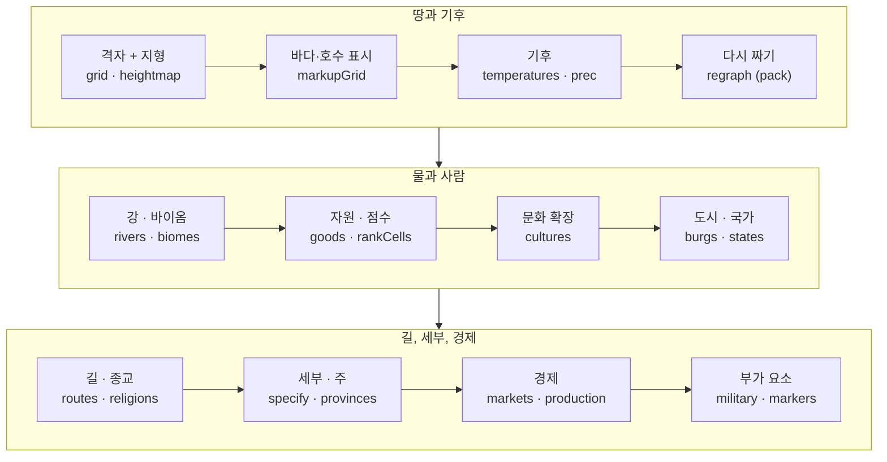
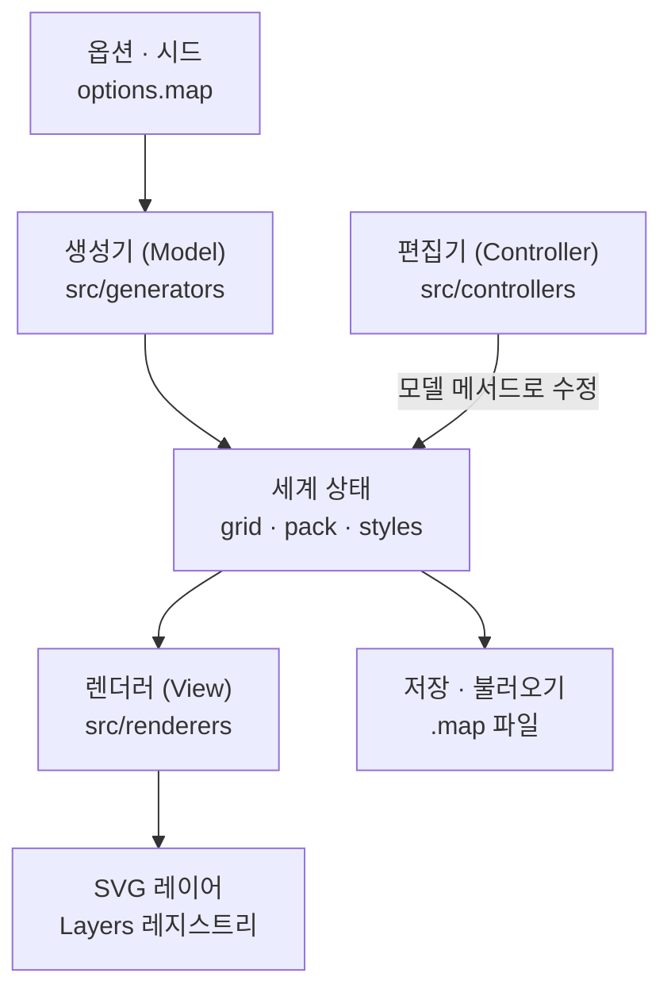

[](/static/images/fmg/hero.webp)

## 1. 왜 Fantasy Map Generator인가요?

판타지 소설을 쓰거나 TRPG를 진행하는 사람에게 지도는 늘 필요하지만 직접 그리기는 어렵습니다. 해안선만 그려서는 부족합니다. 산맥이 어디로 뻗는지, 강이 어느 쪽으로 흐르는지, 사막과 숲이 어디에 생기는지, 그 땅에 어떤 나라가 들어서는지까지 서로 맞아야 그럴듯한 세계가 됩니다.

[Fantasy Map Generator](https://github.com/Azgaar/Fantasy-Map-Generator)(이하 FMG)는 이 일을 버튼 하나로 해 줍니다. 2017년 3월에 시작해 GitHub 별 6,100개와 포크 1,000개를 받았고 최근 5주 동안에도 커밋이 60개 넘게 올라왔습니다. 이번에 분석한 버전은 10월 16일에 나온 v1.154.2입니다.

FMG가 만드는 것은 **데이터로 된 세계**입니다. 셀마다 높이, 기온, 강수량, 바이옴, 문화, 종교, 국가, 주(province)가 들어 있고 도시마다 인구와 성벽 여부, 국가마다 정치 형태와 외교 관계가 있습니다. 지도는 이 데이터를 SVG로 그린 결과일 뿐입니다. 그래서 같은 세계를 정치 지도, 문화 지도, 기후 지도로 바꿔 볼 수 있습니다. 편집기로 강 하나를 옮기면 그 위의 데이터도 함께 바뀝니다.

이 글은 그 세계가 어떤 순서로, 어떤 알고리즘으로 만들어지는지를 코드로 따라갑니다.

## 2. 한 문장으로 이해하기

**FMG**는 시드로 고정한 난수로 지터 격자를 만들고 그 위에 Voronoi 셀을 깐 다음, 지형 → 기후 → 물 → 사람 → 경제 순서로 생성 단계 40개를 돌려 결과를 SVG 레이어로 그리는 **브라우저 전용 세계 생성기**입니다.

| 질문                           | FMG의 답                                                                                                                  |
| ------------------------------ | ------------------------------------------------------------------------------------------------------------------------- |
| 서버가 필요한가요?             | 아니요. 생성, 편집, 렌더링, 저장이 모두 브라우저 안에서 돌아갑니다. 같은 코드를 Electron으로 감싼 데스크톱 앱도 있습니다. |
| 지도의 기본 단위는 무엇인가요? | Voronoi 셀입니다. 기본 설정에서는 1만 개입니다.                                                                           |
| 지형은 어떻게 만드나요?        | `Hill 1 90-100 44-56 40-60` 같은 명령을 적은 템플릿 14종 중 하나를 실행합니다.                                            |
| 나라 국경은 어떻게 정하나요?   | 수도에서 시작하는 다중 출발점 Dijkstra입니다. 비용 함수에 지형, 바이옴, 강, 문화가 들어갑니다.                            |
| 같은 시드면 같은 세계인가요?   | 그렇습니다. `Math.random` 자체를 시드 고정 PRNG(Alea)로 바꿔 끼웁니다.                                                    |
| 결과는 어떻게 저장하나요?      | 세계 전체를 `.map` 파일 하나로 직렬화합니다. 다시 열어도 같은 지도가 나온다는 약속이 이 프로젝트의 불변식입니다.          |
| 라이선스는요?                  | MIT입니다.                                                                                                                |

## 3. 기존 글과의 관계

| 대상                                                                                      | 관계                                                                                                                                                                                         |
| ----------------------------------------------------------------------------------------- | -------------------------------------------------------------------------------------------------------------------------------------------------------------------------------------------- |
| [HyperFrames](/kb/2026-10-07-hyperframes-architecture)                                    | 둘 다 결정성이 핵심입니다. HyperFrames는 페이지의 시계를 가짜 시계로 바꿔서 같은 입력이 같은 영상이 되게 했고, FMG는 `Math.random`을 시드 PRNG로 바꿔서 같은 시드가 같은 세계가 되게 합니다. |
| [Minecraft를 Elden Ring 안에서 돌리는 브릿지](/kb/2026-10-07-minecraft-elden-ring-bridge) | 둘 다 게임 세계를 데이터로 다룹니다. 브릿지 글은 이미 있는 두 게임의 세계를 한 화면에 합쳤고, FMG는 빈 캔버스에서 지형과 국가까지 세계 데이터를 새로 만듭니다.                               |

## 4. 기술 스택과 규모

TypeScript로 옮기는 작업이 한창입니다. 테스트를 뺀 `src/` 아래 TypeScript는 384개 파일, 약 10만 8천 줄입니다. 주요 폴더는 다음과 같습니다.

| 폴더               | 파일 수 | 코드 줄 수 | 역할                                                         |
| ------------------ | ------: | ---------: | ------------------------------------------------------------ |
| `src/controllers/` |     113 |     45,544 | 편집기, 도구, 대화 상자, 개요 화면, AI 어시스턴트            |
| `src/generators/`  |      48 |     22,865 | 절차적 생성 로직(지형, 기후, 강, 문화, 국가, 경제 …)         |
| `src/renderers/`   |      76 |     12,115 | 세계 데이터를 SVG 레이어로 그리는 코드                       |
| `src/components/`  |      50 |      9,086 | 앱 상태(레이어, 옵션, 확대·이동)와 재사용 UI                 |
| `src/services/`    |      35 |      8,453 | 저장·불러오기·내보내기, PWA, 자동 업데이트                   |
| `src/data/`        |      27 |      5,806 | 지형 템플릿, 이름 사전, 문장(紋章) 카탈로그 같은 정적 데이터 |
| `src/utils/`       |      24 |      3,460 | 순수 함수 도우미                                             |

테스트 파일은 206개입니다. 화면 틀과 지도 SVG 구조는 44KB짜리 `src/index.html` 한 파일에 들어 있습니다.

런타임 의존성은 9개뿐입니다. `d3`(기하, 스케일, 쿼드트리), `delaunator`(Delaunay 삼각분할), `alea`(시드 PRNG), `polylabel`(라벨 위치), `lineclip`, `three`(3D 보기), `zod`(스타일 스키마), `quill`(노트 편집기), `driver.js`(튜토리얼)입니다. 빌드는 Vite, 린트는 Biome입니다. React 같은 UI 프레임워크는 쓰지 않습니다. 렌더러는 SVG 문자열을 조립해서 DOM에 한 번에 넣습니다.

## 5. 직접 지도를 만들어 봤습니다

저장소를 클론하고 `npm ci` 뒤 Vite 개발 서버를 띄우면 바로 지도가 하나 만들어집니다. URL에 `?seed=`를 붙이면 그 시드로 만듭니다.

처음에는 시드 `20261019`로 열었습니다. 북쪽 절반이 하얗게 얼어붙은 지도가 나왔습니다.

[](/static/images/fmg/first-polar.webp)

이유는 옵션에 있었습니다. 이 시드에서는 지도 크기(`mapSize`)가 100%로 정해졌습니다. 지도 한 장이 북위 90°부터 남위 90°까지 지구 전체를 덮는다는 뜻입니다. 위쪽 셀은 극지방이라 기온이 영하로 떨어졌고 기온이 −5°C보다 낮은 셀은 바이옴 표에서 곧바로 빙하가 됩니다. 강도 17개밖에 생기지 않았습니다. 강수 계산이 −5°C 미만인 영구동토 셀을 건너뛰기 때문에 북쪽 땅에는 비가 거의 내리지 않습니다. 기후 모델이 정해진 위도대로 정확히 동작한 결과입니다.

시드를 몇 개 바꿔 보다가 `2026`으로 정했습니다. 이 시드에서는 지형 템플릿으로 Archipelago(군도)가 뽑혔고 지도 크기는 58%로 정해졌습니다. 위도로는 북위 62.8°부터 남위 41.6°까지 104.4°를 덮어서 적도가 지도 안에 들어옵니다. 이 뒤에 나오는 화면은 모두 이 지도에서 찍었습니다.

| 항목         | 값                                                                                                  |
| ------------ | --------------------------------------------------------------------------------------------------- |
| 셀           | 격자 9,975개 → 다시 짠 그래프(pack) 4,211개 (요청은 1만 개, 정사각형 격자에 맞추느라 조금 적습니다) |
| 국가         | 25개 (왕국 5, 군주국 5, 공국 4, 대공국 4, 제국 3, 공화국 2, 신정 1, 자치령 1)                       |
| 도시         | 493개                                                                                               |
| 문화         | 10개 (일반 5, 해양 2, 강 2, 호수 1)                                                                 |
| 종교         | 16개 (민속 10, 조직 3, 컬트 2, 이단 1)                                                              |
| 주(province) | 179개                                                                                               |
| 강           | 195개                                                                                               |
| 길           | 407개 (도로 21, 오솔길 262, 항로 124)                                                               |
| 시장         | 19개                                                                                                |
| 생성 시간    | 파이프라인 216ms (3회 중앙값)                                                                       |

같은 지도를 레이어만 바꿔 보면 세계가 어떤 층으로 쌓여 있는지 보입니다. 왼쪽 위부터 높이, 기온, 바이옴, 문화, 국가, 주입니다.

| 높이                                                                                                                                                                        | 기온                                                                                                                                                                                               |
| --------------------------------------------------------------------------------------------------------------------------------------------------------------------------- | -------------------------------------------------------------------------------------------------------------------------------------------------------------------------------------------------- |
| [](/static/images/fmg/heightmap.webp) | [](/static/images/fmg/temperature.webp) |
| **바이옴**                                                                                                                                                                  | **문화**                                                                                                                                                                                           |
| [](/static/images/fmg/biomes.webp)     | [](/static/images/fmg/cultures.webp)                        |
| **국가**                                                                                                                                                                    | **주**                                                                                                                                                                                             |
| [](/static/images/fmg/states.webp)          | [](/static/images/fmg/provinces.webp)                                                             |

종교 레이어를 켜 보면 문화 지도와 거의 똑같습니다. 민속 종교(Folk)는 문화마다 하나씩 생겨 문화 영역을 그대로 복사합니다. 조직 종교 3개와 컬트 2개만 그 위에 따로 퍼집니다.

확대하면 셀 단위의 디테일이 나옵니다. 국경은 산등성이를 따라 꺾이고 도로는 호수를 돌아가며 도시 이름은 서로 겹치지 않게 놓입니다.

[](/static/images/fmg/detail-zoom.webp)

스타일 프리셋을 바꾸면 같은 데이터가 전혀 다른 지도가 됩니다. 스타일도 세계 데이터의 일부라서 `.map` 파일에 함께 저장됩니다.

[](/static/images/fmg/styles.webp)

## 6. 전체 그림: 40단계 생성 파이프라인

생성 순서는 `src/generators/generation-pipeline.ts`에 단계 목록으로 선언되어 있습니다. 예전에는 `generate()` 함수 안에 호출이 하드코딩되어 있었는데 지금은 `{ id, run }` 객체 40개를 담은 배열입니다.

```ts
const generationPipelineSteps = [
  { id: 'grid', run: ({ graph }) => Grid.prepare(graph) },
  { id: 'heightmap', run: () => HeightmapGenerator.generate() },
  { id: 'markupGrid', run: () => Features.markupGrid() },
  // ... 35개 생략
  { id: 'addedLabels', run: () => AddedLabels.initiate() },
  { id: 'journeys', run: () => Journeys.generate() },
] as const satisfies PipelineStep<string, GenerationContext>[]
```

러너(`pipeline.ts`)는 배열을 앞에서부터 실행할 뿐 순서를 바꾸지 않습니다. 단계마다 `performance.measure`를 남기고 실패하면 `Generation Pipeline failed at step "rivers": ...`처럼 어느 단계에서 실패했는지 알려 줍니다.

의존성 그래프는 따로 없습니다. 문서에 따르면 예전에는 단계마다 `dependsOn` 목록을 두었는데 항상 바로 앞 단계만 가리켰다고 합니다. 실제 생성 순서가 한 줄짜리 직선이었기 때문에 검증 로직만 늘고 하는 일은 없어서 지웠습니다. 생성기들은 전역 `grid`와 `pack` 객체를 통해 데이터를 주고받으므로 **실행 순서가 곧 의존성 그래프**입니다.



아래 막대는 시드 2026 지도를 만들 때 단계별로 걸린 시간입니다. 단계를 누르면 그 단계가 무엇을 하는지와 결과 화면이 나옵니다.

<FmgPipeline lang="ko" />

1만 포인트 지도에서 가장 오래 걸린 단계는 지형이나 국가가 아니라 경제의 `production`이었습니다. 65.5ms로 파이프라인 216ms의 30%입니다. 두 번째는 도로망을 까는 `routes`(31.6ms)입니다.

포인트 수를 바꿔 같은 시드로 다시 측정했습니다. 포인트 수가 바뀌면 격자가 달라지므로 지도 모양도 달라집니다. 도시 수는 사람이 사는 셀 수를 `(포인트 수 / 1만)^0.8`로 나눠 자동으로 정하므로, 포인트가 늘면 도시는 오히려 줄어듭니다.

|  포인트 | pack 셀 | 도시 | 파이프라인 | `grid` | `rivers` | `routes` | `production` |
| ------: | ------: | ---: | ---------: | -----: | -------: | -------: | -----------: |
|  10,000 |   4,211 |  493 |      216ms |   15.1 |     11.6 |     31.6 |         65.5 |
|  30,000 |   8,158 |  418 |      358ms |   34.3 |     45.5 |     50.6 |         66.2 |
| 100,000 |  18,944 |  379 |      755ms |   93.5 |     77.6 |    157.3 |         71.5 |

포인트가 10배가 되자 파이프라인 전체는 3.5배 느려졌지만 `production`은 거의 그대로였습니다. 생산 시뮬레이션은 도시와 시장 수에 비례할 뿐 셀 수와는 상관이 없습니다. 반대로 격자, 강, 길처럼 셀 그래프를 도는 단계는 셀 수를 따라 늘어서 10만 포인트에서는 `routes`가 가장 오래 걸리는 단계가 됩니다.

## 7. 미니 FMG로 먼저 돌려 보기

아래는 FMG의 앞쪽 단계를 1,400개 셀 규모로 줄여 이 블로그에 다시 구현한 것입니다. 지터 격자, Voronoi, 지형 템플릿 명령, 웅덩이 메우기와 물 흐름, 수도에서 시작하는 Dijkstra 확장을 FMG와 같은 방식으로 계산합니다. 시드를 바꾸면 세계가 바뀌고 같은 시드로 돌아오면 같은 세계가 다시 나옵니다. 마지막 단계에서는 국경이 어떤 순서로 정해지는지 재생해 볼 수 있습니다.

<FmgWorldBuilder lang="ko" />

이제 각 단계를 실제 코드로 보겠습니다.

## 8. 그래프 두 개: grid와 pack

### 8.1 지터를 준 정사각형 격자

FMG의 셀은 무작위 점에서 시작하지 않습니다. 먼저 원하는 셀 수에 맞춰 간격 `spacing = √(W·H / cells)`인 정사각형 격자를 깔고 점을 각자의 칸 안에서 반지름의 90%까지 흔듭니다.

```ts
private getJitteredPoints(width: number, height: number, spacing: number): Point[] {
  const radius = spacing / 2;
  const jittering = radius * 0.9;
  const doubleJittering = jittering * 2;
  const jitter = () => Math.random() * doubleJittering - jittering;
  // 각 칸 중심 + jitter()
}
```

완전한 무작위 점은 뭉치거나 비는 곳이 생겨 셀 크기가 들쭉날쭉해집니다. 격자에 지터를 주면 셀 크기는 고르면서도 모양은 자연스럽습니다. 점이 원래 칸을 벗어나지 않으니 덤으로 `findCell(x, y)`도 나눗셈 두 번으로 끝낼 수 있습니다. 다만 이 함수가 돌려주는 것은 좌표가 속한 칸이라서, 셀 경계 근처에서는 실제로 가장 가까운 점의 셀과 다를 수 있는 근사입니다.

이 점들을 `delaunator`로 삼각분할하고 삼각형마다 외심을 구해 Voronoi 꼭짓점으로 씁니다(`voronoi.ts`). 지도 가장자리 바깥에는 셀을 갖지 않는 경계 점을 둘러서 바깥쪽 셀이 무한히 늘어나지 않게 자릅니다.

### 8.2 쓸모 있는 곳에만 셀을 다시 짭니다

지형과 기후를 정한 뒤 `regraph` 단계에서 두 번째 Voronoi 그래프 `pack`을 만듭니다. 깊은 바다 점은 버리고 해안 셀 사이에는 중점을 하나씩 더 넣습니다.

```ts
if (height < SEA_LEVEL && type !== -1 && type !== -2) continue; // 깊은 바다는 버립니다
...
if (type === 1 || type === -1) {            // 해안 셀이면
  for (const e of gridCells.c[i]) {
    if (gridCells.t[e] !== type) continue;
    if (dist2 < spacing2) continue;
    addNewPoint(i, (x + points[e][0]) / 2, (y + points[e][1]) / 2, height);
  }
}
```

아무도 살지 않는 먼바다에는 해상도가 필요 없지만 해안선은 해상도가 높을수록 보기 좋습니다. 시드 2026 지도에서는 격자 9,975개가 pack 4,211개가 되었습니다. 강, 문화, 국가처럼 뒤에 오는 모든 것은 pack 셀 위에서 계산합니다. 문서는 이 단계를 "앞서 쓴 pack 셀 번호를 모두 무효로 만든다"고 경고합니다.

[](/static/images/fmg/cells-zoom.webp)

### 8.3 셀 객체 대신 배열 묶음

셀 데이터는 셀마다 객체를 만드는 대신 같은 길이의 typed array 여러 개에 나눠 담습니다. `pack.cells.h`는 `Uint8Array`, `cells.biome`도 `Uint8Array`, `cells.pop`은 `Float32Array`입니다. 셀 `i`의 높이는 `cells.h[i]`, 바이옴은 `cells.biome[i]`입니다. 셀 10만 개짜리 지도에서도 메모리가 적게 들고 루프가 빠릅니다. 아키텍처 문서는 이것을 "structure-of-arrays"라고 부르고 반드시 지킬 규칙으로 정해 두었습니다.

## 9. 지형: 템플릿 언어로 쌓는 높이

FMG는 노이즈 함수 대신 **명령 스크립트**로 지형을 만듭니다. 템플릿 14종이 `src/data/heightmap-templates.ts`에 있고 한 줄이 명령 하나입니다. 형식은 `도구 개수 높이 x범위(%) y범위(%)`입니다.

```text
Hill 1 80-85 60-80 40-60        ← 높이 80~85짜리 언덕 1개를 오른쪽 가운데에
Hill 1 80-85 20-30 40-60        ← 왼쪽에도 하나
Hill 6-7 15-30 25-75 15-85      ← 낮은 언덕 6~7개를 여기저기
Multiply 0.6 land 0 0           ← 육지 높이를 0.6배로
Range 1-2 30-60 5-15 25-75      ← 산맥 1~2개
Strait 2 vertical 0 0           ← 세로 해협
Smooth 3 0 0 0                  ← 이웃 평균으로 다듬기
Pit 3-4 10-20 15-85 20-80       ← 움푹 팬 곳
Mask 4 0 0 0                    ← 가장자리를 바다로
```

위 스크립트가 Continents(대륙) 템플릿입니다. 템플릿마다 뽑힐 가중치가 있어서 High Island 19, Archipelago 18, Continents 16 순으로 자주 나옵니다.

명령 하나하나는 단순합니다. `Hill`은 시작 셀에 높이를 주고 BFS로 이웃에게 조금씩 줄여서 퍼뜨립니다.

```ts
change[start] = h
const queue = [start]
while (queue.length) {
  const q = queue.shift()
  for (const c of this.grid.cells.c[q]) {
    if (change[c]) continue
    change[c] = change[q] ** this.blobPower * (Math.random() * 0.2 + 0.9)
    if (change[c] > 1) queue.push(c)
  }
}
```

`blobPower`는 1보다 조금 작은 지수입니다. 높이 90에 0.98제곱을 하면 약 82가 되고 이 값을 이웃으로 넘길 때마다 줄어듭니다. 셀이 촘촘해져도 언덕의 실제 크기가 같도록, 셀 수가 많을수록 `blobPower`를 1에 가깝게 둡니다(1,000셀 0.93, 1만 셀 0.98, 10만 셀 0.9973). 매 단계 0.9~1.1 사이 난수를 곱해서 언덕 가장자리가 울퉁불퉁해집니다.

`Range`는 시작 셀에서 끝 셀까지 이웃 중 끝에 가장 가까운 셀로 한 칸씩 걸어가며 능선을 만듭니다. 이때 15% 확률로 거리를 절반으로 계산하는 셀이 섞여 있어서 능선이 곧게 뻗지 않고 구불구불해집니다. `Mask`는 `(1 - nx²)(1 - ny²)`를 곱해 지도 가장자리를 바다로 끌어내립니다.

## 10. 기후: 위도와 바람

### 10.1 기온

기온은 행(row)마다 위도로 정하고 셀마다 고도만큼 깎습니다.

```ts
const getAltitudeDrop = (height: number) => {
  if (height < SEA_LEVEL) return 0
  return rn(((height - 18) ** exponent / 1000) * 6.5)
}
```

1km 오를 때마다 6.5°C 떨어진다는 실제 기온 감률을 그대로 씁니다. 적도 기온과 두 극의 기온은 옵션이고 남북 회귀선(북위 16°, 남위 20°) 안쪽은 따로 완만한 기울기를 씁니다. 그래서 기온 레이어는 가로 띠 모양이고 산이 있는 곳만 등온선이 휩니다.

### 10.2 강수량

`precipitation-generator.ts`의 첫 줄 주석은 "가장 단순한 강수 모델"입니다. 위도 30°마다 바람 방향이 옵션으로 정해져 있고(무역풍, 편서풍, 극동풍), 바람은 지도 가장자리 행이나 열에서 들어와 셀을 하나씩 지나갑니다.

- 바다 셀을 지나면 습기를 얻습니다.
- 육지 셀에서는 습기의 일부를 비로 내립니다. 다음 셀이 더 높으면 더 많이 내립니다(지형성 강수).
- 높이 85를 넘는 셀은 넘지 못합니다. 바람은 그 앞에 습기를 모두 쏟고 마릅니다. 산맥 뒤가 건조해지는 비 그늘이 이렇게 생깁니다.
- 위도 5° 띠마다 계수가 있습니다(적도 ×4, 아열대 고압대 20~30° ×1, 위도 50~60° ×3). 실제 대기 대순환의 상승대와 하강대를 흉내 낸 값입니다.

[](/static/images/fmg/precipitation.webp)

## 11. 물: 웅덩이를 메우고 물을 흘려보냅니다

### 11.1 웅덩이 메우기

물을 높은 곳에서 낮은 곳으로 흘리려면 먼저 물이 갇히는 웅덩이(depression)를 없애야 합니다. `resolveDepressions`는 낮은 셀부터 보면서 이웃보다 낮거나 같은 셀을 가장 낮은 이웃보다 0.1 높게 올립니다. 이것을 웅덩이가 없어질 때까지 반복합니다(기본 최대 250회). 호수는 수면 높이를 0.2씩 올립니다. 반복이 길어지면 그 호수는 물이 빠져나가지 않는 닫힌 호수로 확정합니다.

여러 번 돌아도 웅덩이 수가 줄지 않으면 높이를 원래대로 돌리고 멈춥니다.

### 11.2 물 흘려보내기

`drainWater`는 육지 셀을 **높은 순서대로** 한 번 훑습니다.

```ts
const land = cells.i.filter(i => h[i] >= 20).sort((a, b) => h[b] - h[a]);
for (const i of land) {
  cells.fl[i] += prec[cells.g[i]] / cellsNumberModifier; // 내린 비를 더하고
  ...
  const min = cells.c[i].reduce((m, c) => (h[c] < h[m] ? c : m)); // 가장 낮은 이웃으로
  if (cells.fl[i] < MIN_FLUX_TO_FORM_RIVER) { cells.fl[min] += cells.fl[i]; continue; }
  if (!cells.r[i]) cells.r[i] = riverNext++; // 충분히 모이면 새 강
  flowDown(min, cells.fl[i], cells.r[i]);
}
```

높은 셀부터 처리하기 때문에 셀에 도착했을 때는 위쪽에서 내려올 물이 이미 다 모여 있습니다. 정렬 한 번과 순회 한 번으로 유역 전체의 유량이 계산됩니다. 두 강이 만나면 유량이 큰 쪽이 본류가 되고 작은 쪽은 지류로 기록됩니다. 그 뒤 `downcutRivers`가 유량이 큰 강바닥을 최대 5까지 깎아 계곡을 만듭니다.

### 11.3 바이옴은 표 하나로 고릅니다

바이옴은 기온 26칸 × 습도 5칸짜리 표에서 고릅니다. 습도는 강수량에 강 유량을 더한 값입니다. 표보다 먼저 확인하는 예외가 세 가지 있습니다. −5°C 미만이면 빙하, 25°C 이상에 강이 없고 건조하면 열대 사막, 습도가 아주 높은 저지대면 습지입니다.

```ts
if (temperature < -5) return 11 // Glacier
if (temperature >= 25 && !hasRiver && moisture < 8) return 1 // Hot desert
if (this.isWetland(moisture, temperature, height)) return 12 // Wetland
const moistureBand = Math.min((moisture / 5) | 0, 4) // 0~4
const temperatureBand = Math.min(Math.max(20 - temperature, 0), 25) // 0~25
return biomesMatrix[moistureBand][temperatureBand]
```

바이옴마다 **거주 적합도**(habitability)와 **이동 비용**(cost)이 같이 붙어 있습니다. 온대 활엽수림은 적합도 100에 비용 70이고 빙하는 적합도 0에 비용 5,000입니다. 다음 단계에서는 이 두 숫자를 보고 사람이 어디에 살지, 나라가 어디까지 퍼질지 정합니다.

## 12. 사람: 점수를 매기고 Dijkstra로 퍼뜨립니다

### 12.1 살기 좋은 셀에 점수를 매깁니다

`rankCells`는 육지 셀마다 점수 `s`를 매깁니다.

```ts
let score = biomes[cells.biome[i]].habitability // 바이옴 적합도에서 시작
if (meanFlux) score += normalize(cells.fl[i] + cells.conf[i], meanFlux, maxFlux) * 250 // 큰 강과 합류점
score -= (cells.h[i] - 50) / 5 // 높을수록 감점
// 해안이면: 하구 +15, 바다 +5, 좋은 항구 +20, 민물 호수 +30 …
```

여기에 그 셀과 주변 셀의 자원(goods) 가치를 더하고 셀 넓이에 비례해 시골 인구 `pop`을 정합니다. 뒤 단계에서 문화 중심, 수도, 마을 위치를 고를 때 이 점수를 씁니다.

### 12.2 문화: 비용이 싼 셀부터 넓힙니다

문화 중심은 점수가 높은 셀을 골라 서로 일정 거리 이상 떨어지게 놓습니다. 중심 셀의 환경에 따라 문화 유형이 정해집니다. 사막이나 초원의 낮은 땅이면 유목(Nomadic), 높이 50을 넘으면 고원(Highland), 좋은 항구가 있으면 해양(Naval), 큰 강가면 강(River) 문화가 됩니다.

확장은 모든 중심에서 동시에 출발하는 Dijkstra입니다. 우선순위 큐(`FlatQueue`)에서 누적 비용이 가장 작은 셀을 꺼내고 이웃 셀로 가는 비용을 더해 다시 넣습니다. 셀은 가장 싸게 도착한 문화가 차지합니다.

```ts
const cellCost = (biomeCost + biomeChangeCost + heightCost + riverCost + typeCost) / expansionism
const totalCost = priority + cellCost
```

비용 항목마다 문화 유형이 개입합니다.

| 비용          | 기본                         | 유형별 예외                                               |
| ------------- | ---------------------------- | --------------------------------------------------------- |
| 바이옴        | 고향 바이옴 10, 그 외 비용×2 | 사냥(Hunting) 비용×5, 유목은 숲에서 비용×10               |
| 바다 건너기   | 셀 넓이×6                    | 해양 넓이×2, 유목 넓이×50, 호수 문화는 호수 위 10         |
| 높이          | 산 200, 언덕 30              | 고원 문화는 반대로 낮은 땅이 비쌉니다(높이 44 미만 3,000) |
| 강            | 유량에 따라 20~100           | 강 문화는 강 위 0, 강을 벗어나면 100                      |
| 해안과의 거리 | 해안선 20                    | 해양·호수 문화는 해안선 0, 내륙 깊이 들어가면 100         |

해양 민족이 해안을 따라 길게 퍼지고 고원 민족이 산에 머물고 유목민이 숲을 피하는 모습이 모두 이 표에서 나옵니다. 그런 규칙을 코드에 따로 적지는 않았습니다.

### 12.3 국가: 같은 알고리즘, 다른 비용

수도는 점수에 0.5~1 사이 난수를 곱해 정렬한 뒤, 서로 `(W+H)/2/국가 수`만큼 떨어지게 놓습니다. 자리가 모자라면 간격을 1.2로 나누고 다시 시도합니다. 수도 하나가 국가 하나가 됩니다.

국경도 Dijkstra로 정합니다.

```ts
const cultureCost = culture === cells.culture[e] ? -9 : 100;
const populationCost = cells.h[e] < 20 ? 0 : cells.s[e] ? Math.max(20 - cells.s[e], 0) : 5000;
...
const cellCost = Math.max(cultureCost + populationCost + biomeCost + heightCost + riverCost + typeCost, 0);
const totalCost = p + 10 + cellCost / states[s].expansionism;
```

문화 확장과 다른 점은 두 가지입니다. 같은 문화의 셀에 들어가면 비용이 9 줄고 다른 문화면 100이 붙습니다. 그래서 국경이 문화 경계를 따라가는 경향이 생깁니다. 아무도 살 수 없는 셀은 5,000이라 거의 넘지 못합니다. 산은 2,200, 바다는 1,000(해양 국가 300)으로 문화보다 훨씬 비쌉니다. 국가마다 다른 `expansionism`(1 이상의 난수)으로 비용을 나눠서 어떤 나라는 크게, 어떤 나라는 작게 자랍니다.

확장이 끝나면 한 번 다듬습니다. 다른 나라 셀에 둘러싸인 셀은 그 나라로 넘어가서 국경이 들쭉날쭉해지지 않습니다.

국가 형태는 마지막에 정합니다. 면적을 중앙값과 비교해 0~4단계로 나누고 군주정이면 공국(Duchy) → 대공국 → 군주국(Principality) → 왕국 → 제국 순으로 이름을 붙입니다. 이름 사전에 따라 몽골 계열은 칸국(Khanate), 튀르크 계열은 카간국(Khaganate), 아랍 계열은 에미레이트가 됩니다. 앞에서 본 첫 지도의 "Baylian Khaganate"가 이렇게 나왔습니다.

수도의 종교가 국가 단위 종교이면 신정(Theocracy)이 됩니다. 수도의 종교가 조직 종교나 컬트일 때도 10% 확률로 신정이 됩니다.

### 12.4 종교와 주

종교도 같은 구조입니다. 민속 종교는 문화 영역을 그대로 복사하고 조직 종교와 컬트는 큰 도시에서 시작해 Dijkstra로 퍼집니다. 종교의 이동 비용은 길 위에서 1, 길 밖에서는 바이옴 비용입니다. 그래서 조직 종교는 도로망을 따라 퍼집니다. 확장력이 큰 조직 종교는 자기 영역 가장자리에 이단(Heresy)을 0~3개 만듭니다.

주(province)는 국가마다 큰 도시 순으로 중심을 고르고 국경 밖으로 나가지 않는 Dijkstra로 나눕니다. 비용은 높이뿐입니다. 남은 땅은 다시 flood fill로 묶어 섬(Island), 영토(Territory) 같은 이름을 붙이고 수도까지 육로가 없으면 50% 확률로 "New ○○" 식민지가 됩니다.

## 13. 길과 이름

### 13.1 Urquhart 그래프를 따라 길을 냅니다

도로망은 모든 도시 쌍을 잇는 대신 도시 위치로 Delaunay 삼각분할을 한 뒤 삼각형마다 가장 긴 변을 지웁니다. 이것이 Urquhart 그래프입니다. 남은 간선은 가까운 이웃끼리만 이어서 실제 도로망처럼 보입니다.

간선마다 셀 그래프 위에서 Dijkstra로 실제 경로를 찾습니다. 순서는 항로 → 수도 사이 도로 → 모든 도시 사이 오솔길입니다. 비용은 거리 제곱에 높이, 거주 적합도를 곱하고 **이미 길이 난 구간은 절반**만 받습니다.

```ts
const connectionModifier = this.connections.has(`${current}-${next}`) ? 0.5 : 1
const burgModifier = pack.cells.burg[next] ? 1 : 3
```

그래서 나중에 내는 길이 먼저 난 길에 합류하고 도시가 있는 셀을 지나려는 경향이 생깁니다. 길이 다 깔린 뒤에 도시 인구를 정합니다(`burgsSpecify`). 도로가 많이 지나는 도시일수록 인구에 연결성 계수가 곱해져 커집니다. 파이프라인 순서 덕분에 "교통이 좋은 곳에 큰 도시가 생긴다"는 인과가 생깁니다.

### 13.2 이름은 음절 마르코프 체인으로 만듭니다

도시, 국가, 강 이름은 언어별 이름 사전 43개(`src/data/name-bases.ts`)에서 배운 마르코프 체인으로 만듭니다. 실제 지명을 모음과 자음이 바뀌는 지점에서 최대 5글자 음절로 자르고 "앞 음절의 마지막 글자 → 다음 음절" 표를 만듭니다.

생성할 때는 빈 문자열에서 출발해 마지막 글자에 맞는 음절을 무작위로 이어 붙이고 길이 범위 안에서 끝 표시(종료 토큰)가 나오면 멈춥니다. 영어 지명으로 배운 체인에서는 이렇게 "Grantford", "Oakburgh" 같은 이름이 나옵니다.

## 14. 경제: 셀 수와 상관없이 무거운 단계

경제는 파이프라인 뒤쪽에 붙은 별도의 시뮬레이션입니다. 자원(goods) 71종이 있고 각 자원의 분포 규칙은 문자열로 적혀 있습니다. 생성기는 이 문자열을 `new Function`으로 실행해서 `biome()`, `minHeight()`, `river()` 같은 도우미로 셀마다 참·거짓을 판단합니다.

그 위에서 다음 순서로 한 번 돌아가는 시뮬레이션입니다.

1. **시장**: 수도와 항구에 가중치를 줘서 시장 도시를 고르고 Dijkstra로 시장권을 나눕니다. 다른 나라로 넘어가거나 바다를 건너면 비용이 붙습니다.
2. **생산**: 시골 셀이 바이옴에 맞는 원료를 시장에 내놓습니다. 도시는 인구가 적은 순으로 레시피를 보고 이익이 가장 큰 물건을 만들어 팝니다.
3. **교역**: 시장 사이 가격 차이가 운송비와 세금보다 크면 물건이 옮겨 갑니다.
4. **세금**: 거래세와 인두세가 국고로 들어갑니다.

시드 2026 지도에서는 시장 19개가 생겼고 이 시뮬레이션의 `production` 단계가 65.5ms 걸렸습니다. 앞에서 본 것처럼 이 시간은 셀 수가 늘어도 거의 변하지 않습니다.

## 15. 같은 시드, 같은 세계

FMG는 생성 전에 `Math.random` 자체를 시드 고정 PRNG로 바꿔 끼우는 단순한 방법으로 결정성을 얻습니다.

```ts
// src/components/seed.ts
Math.random = aleaPRNG(options.map.seed)
```

생성기 코드는 `Math.random()`, 그리고 그 위에 만든 `rand`, `P`, `gauss`, `rw` 같은 도우미만 씁니다. d3의 정규분포도 `d3.randomNormal.source(() => Math.random())`로 같은 난수원을 쓰게 했습니다.

여러 생성기는 여기에 더해 시작할 때 난수를 **다시** 시드합니다.

```ts
// precipitation-generator.ts
Math.random = Alea(options.map.seed) // the same winds for the same map, whoever rolled before
```

격자, 지형, 바다 표시, 강수, 강, 자원, 길, 주, 시장 단계가 이렇게 합니다. 앞 단계가 난수를 몇 개 썼는지와 상관없이 이 단계의 결과가 같아집니다. 그래서 지형 편집기에서 산 하나를 지우고 뒤 단계만 다시 돌려도(`ErasePipeline`) 바람과 자원 배치는 그대로 유지됩니다.

실제로 확인해 봤습니다. 시드 2026으로 만들고 시드 9999로 다른 지도를 만든 뒤, 다시 2026으로 만들었습니다. 셀 높이, 국가, 문화, 바이옴 배열 전체의 해시를 비교했습니다.

| 생성 순서      | 해시         | 국가 | 도시 | 첫 도시 이름 |
| -------------- | ------------ | ---: | ---: | ------------ |
| 시드 2026      | `3699448255` |   25 |  493 | Axblerid     |
| 시드 9999      | `4280839211` |   17 |  649 | Oxbrok       |
| 다시 시드 2026 | `3699448255` |   25 |  493 | Axblerid     |

시드만 같으면 앞에서 어떤 지도를 만들었든 네 배열의 해시가 정확히 같았습니다.

옵션도 같은 원리를 따릅니다. 국가 수, 템플릿, 기온 같은 생성 옵션은 매번 시드 난수로 다시 뽑힙니다. 사용자가 자물쇠(Pin)를 건 값만 그대로 남습니다. 옵션까지 포함한 세계 전체가 시드 하나로 정해집니다.

## 16. 아키텍처: 네 개의 층과 전역 상태

### 16.1 상태, 생성기, 편집기, 렌더러

FMG는 "FMG 2.0"이라고 부르는 구조로 옮겨 가는 중입니다. 목표 구조는 아키텍처 문서에 이렇게 적혀 있습니다.



생성기는 DOM과 SVG를 만지지 않습니다. 렌더러는 세계 상태를 바꾸지 않고 같은 상태를 두 번 그리면 같은 결과가 나와야 합니다. 편집기는 상태를 바꾼 뒤 렌더러에게 다시 그려 달라고 합니다. 국가 이름 바꾸기 같은 수정도 `States.rename` 같은 모델 클래스의 메서드로만 합니다. 편집기와 AI 어시스턴트가 같은 메서드를 부르므로 수정 로직이 한 군데에만 있습니다.

모듈 사이의 import 방향도 정해져 있습니다. `controllers`는 무엇이든 가져올 수 있지만 `renderers`는 `generators` 아래만, `generators`는 `utils`, `types`, `data`만 가져옵니다. 생성기가 툴팁을 띄우고 싶어도 UI 모듈을 import할 수 없습니다.

### 16.2 레이어 레지스트리

지도의 레이어 39개는 `src/components/layers.ts`에 순서 있는 목록 하나로 선언되어 있습니다. **등록 순서가 곧 z-order이자 초기화 순서이자 그리기 순서**입니다. 생성 파이프라인과 같은 생각입니다. 순서를 데이터로 선언하고 따로 정렬하거나 의존성을 계산하지 않습니다.

레이어를 끄면 그룹을 숨기는 대신 내용을 지웁니다. 숨겨 둔 노드라도 수천 개가 남아 있으면 스타일 계산과 hit test 비용이 계속 들어갑니다. 이 글의 스크린샷은 모두 `Layers.set([...])`으로 레이어 조합을 바꿔 가며 찍었습니다.

### 16.3 렌더링 규칙

렌더러 규칙에는 성능에 관한 내용이 많습니다.

- 레이어 하나를 문자열로 조립해 한 번에 넣습니다. 노드를 루프에서 하나씩 붙이지 않습니다.
- d3는 기하 계산, 스케일, 쿼드트리에만 씁니다. `selectAll().data().enter().append()`로 DOM을 만들지 않습니다. 문서는 data join이 요소마다 클로저와 데이터를 붙잡아 메모리를 쓴다고 설명합니다.
- 같은 값의 셀은 합쳐서 큰 다각형 몇 개로 그립니다. 셀 하나에 path 하나를 쓰지 않습니다.
- 아이콘은 `<defs>`에 한 번 정의하고 `<use>`로 찍습니다.
- 좌표를 반올림해서 path 문자열을 줄입니다.

편집기 대화 상자는 열 때 만들고 닫을 때 없앱니다. 예전에는 모든 대화 상자가 `index.html`에 미리 들어 있었고 보이기와 숨기기만 했습니다. 국가, 문화, 도시처럼 행이 많은 목록이 DOM에 계속 남아서 긴 세션에서는 메모리가 기가바이트 단위로 늘었다고 합니다. 지금은 `Controllers.StatesEditor.open()`처럼 레지스트리를 거쳐 처음 부를 때 모듈을 동적으로 import합니다.

### 16.4 전역 상태라는 현실

목표 구조와 현재 코드 사이에는 거리가 있습니다. 생성기들은 여전히 `window.grid`, `window.pack`, `window.options`를 직접 읽고 씁니다. `Grid`, `Rivers`, `States` 같은 생성기 모듈도 `window`에 자기 자신을 등록합니다. 옛 스크립트가 아직 남아서 이 모듈들을 전역으로 호출하는 탓입니다. 프로젝트의 `CONTEXT.md`도 이 점을 "가장 조심할 부분"으로 꼽고 전역을 명시적인 인자로 바꾸는 리팩터링은 극도로 조심하라고 적어 두었습니다.

## 17. 코드 읽는 추천 순서

1. `CONTEXT.md`, `docs/architecture/architecture.md`: 목표 구조와 규칙입니다.
2. `docs/architecture/generation-pipeline.md`: 단계별로 무엇을 읽고 쓰는지 표로 정리되어 있습니다.
3. `src/generators/generation-pipeline.ts`, `pipeline.ts`: 실제 순서와 러너입니다. 짧습니다.
4. `src/generators/grid-generator.ts`, `voronoi.ts`, `pack-generator.ts`: 그래프 두 개를 만드는 과정입니다.
5. `src/data/heightmap-templates.ts`, `heightmap-generator.ts`: 템플릿 언어와 명령 구현입니다.
6. `temperature-generator.ts`, `precipitation-generator.ts`, `river-generator.ts`, `biomes-generator.ts`: 기후와 물입니다.
7. `population-generator.ts`, `cultures-generator.ts`, `states-generator.ts`: 점수와 Dijkstra 확장입니다. 비용 함수를 비교하며 읽으면 좋습니다.
8. `routes-generator.ts`, `names-generator.ts`: Urquhart 그래프와 마르코프 체인입니다.
9. `src/components/layers.ts`, `src/renderers/`: 상태가 SVG가 되는 과정입니다.

## 18. 인상적인 설계 포인트

**1. 순서를 데이터로 선언합니다.** 생성 단계와 레이어가 모두 순서 있는 배열 하나입니다. 실제 의존 관계가 직선이라는 것을 확인하고 `dependsOn`을 지운 결정까지 문서에 남아 있습니다.

**2. 같은 알고리즘을 비용 함수만 바꿔 다시 씁니다.** 문화, 국가, 종교, 주, 시장이 모두 "다중 출발점 Dijkstra + 비용 함수"입니다. 해양 민족, 고원 왕국, 길을 따라 퍼지는 종교 같은 특징은 모두 비용 표의 숫자에서 나옵니다.

**3. 파이프라인 순서가 인과를 만듭니다.** 도시 인구를 길이 깔린 뒤에 정하기 때문에 교통이 좋은 도시가 커집니다. 자원을 점수 계산 전에 뿌리기 때문에 자원이 있는 곳에 사람이 모입니다.

**4. 해상도를 필요한 곳에만 씁니다.** 먼바다 셀을 버리고 해안 셀을 쪼개서, 같은 셀 수로 해안선을 더 정교하게 그립니다.

**5. 단계마다 난수를 다시 시드합니다.** 앞 단계의 변화가 뒤 단계의 난수에 번지지 않습니다. 편집 후 부분 재생성과 결정성이 같이 성립합니다.

**6. 문서가 코드만큼 자세합니다.** `docs/architecture/`에 생성 파이프라인, 데이터 모델, 설정, 스타일, 지연 로딩, 메모리 관리 규칙이 따로 있고 리뷰할 때 쓸 체크리스트까지 적혀 있습니다. `CLAUDE.md`와 `AGENTS.md`가 이 문서를 먼저 읽으라고 안내합니다.

## 19. 주의해서 볼 지점

**1. 전역 상태가 많습니다.** `grid`, `pack`, `options`가 `window`에 있고 거의 모든 생성기가 이것을 직접 읽습니다. 생성기 하나를 따로 떼어 테스트하거나 Web Worker로 옮기려면 이 의존을 먼저 풀어야 합니다.

**2. 부분 재생성 경로가 여러 개입니다.** 전체 생성, 지형 편집 후 재생성(`ErasePipeline`), 엔티티를 지키는 재생성(Risk), 크기 변환(Resample)이 각자 단계를 복제합니다. `ErasePipeline`은 단계 목록을 손으로 맞추고 있어서 문서도 새 단계를 추가할 때 다섯 군데를 고치라고 안내합니다.

**3. 자원 분포 규칙을 `new Function`으로 실행합니다.** `.map` 파일에 들어 있는 문자열이 코드로 실행됩니다. AI 어시스턴트의 `read_map` 도구도 모델이 쓴 JavaScript를 페이지 권한으로 실행합니다. 프로젝트는 이 위험을 문서에 밝히고 "믿을 수 있는 지도 파일만 열라"고 안내합니다.

**4. 순서에 따른 작은 버그가 있습니다.** 종교 단계는 큰 도시부터 후보로 삼으려고 `burg.population`으로 정렬하는데 인구는 그 뒤 `burgsSpecify` 단계에서 정해집니다. 이 시점에는 값이 없어 비교 결과가 모두 `NaN`이 되므로 정렬이 사실상 일어나지 않습니다. 수도가 먼저 만들어지기 때문에 결과는 크게 어색하지 않습니다.

**5. 고칠 수 없는 옛 동작이 남아 있습니다.** 강수 코드에는 "0번 셀에서 시작하는 바람 띠는 건너뛴다. 고치면 모든 지도가 바뀐다"는 주석이 있습니다. 결정성을 지키는 대가로 버그도 시드의 일부가 되었습니다. 이름 생성기에도 "원래의 이상한 동작"이라고 적힌 조건문이 그대로 남아 있습니다.

**6. 도메인 문서와 코드가 어긋난 곳이 있습니다.** 시장 배치 가중치는 `trade_schema.md`에 수도 ×2, 항구 ×2로 적혀 있지만 코드는 ×2.5와 ×1.2입니다. 숫자를 인용할 때는 코드를 기준으로 삼는 편이 안전합니다.

## 20. 결론

FMG는 시드 하나로 지형, 기후, 물, 사람, 경제를 차례로 쌓아 판타지 세계를 만듭니다. 40개 단계는 배열 하나에 순서대로 선언되어 있고 생성기들은 전역 `grid`와 `pack`으로 결과를 넘깁니다. 지형은 템플릿 명령으로, 강은 높은 셀부터 물을 흘려서, 문화와 국가와 종교는 비용 함수만 다른 Dijkstra로 만듭니다.

직접 측정한 결과도 정리해 둡니다. 시드 2026 지도는 1만 포인트에서 216ms 만에 만들어졌습니다. 다른 지도를 만든 뒤 같은 시드로 돌아와도 주요 배열의 해시가 정확히 같았습니다. 1만 포인트에서는 경제 시뮬레이션이 가장 무거웠습니다. 포인트를 10만 개로 늘리자 그 자리를 셀 그래프 위에서 길을 찾는 `routes`가 차지했습니다.

---

> 분석 일자: 2026-10-19
> 대상 버전: Fantasy Map Generator v1.154.2 (MIT)
> 대상 커밋: `b4a0dcb` (`master` 브랜치, 2026-10-16)
> 저장소: https://github.com/Azgaar/Fantasy-Map-Generator
> 측정 환경: Apple M5 Pro, macOS, Node 24.15, Playwright 1.60 headless Chromium, Vite 8 개발 서버, 1600×900, 시드 2026, 설정마다 3회 생성 후 중앙값

_Claude Code와 함께 작성됨_
