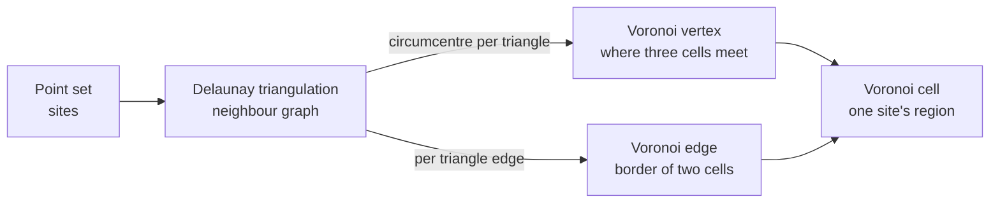

## 1. Why Voronoi?

While writing the [Fantasy Map Generator analysis](/kb/2026-10-19-fantasy-map-generator-architecture), the name Voronoi kept coming up. FMG builds every cell of its map as a Voronoi diagram and builds its road network by pruning the dual, the Delaunay triangulation. Look a little further and the same shape shows up well beyond map generators: in cellular noise shaders, Minecraft's biome borders, the destruction tools in Houdini and Unreal, and coverage models for cell towers.

This post asks why it is so often Voronoi. It covers the definition and history, the relationship with the Delaunay triangulation, how to scatter the points, where it is and is not used, and what to watch out for. I checked sources against papers and the authors' own writing wherever I could, and measured a few things myself.

## 2. In one sentence

A **Voronoi diagram** takes a set of points (sites) in the plane and divides every location in the plane by which site is closest.

Fortune's 1987 paper defines it like this.

> The Voronoi region of a site s is the set of points in the plane for which s is the closest site among all the sites.

The border between two sites lies on the perpendicular bisector of the segment joining them. So every cell is a convex polygon, and a vertex where three cells meet is equidistant from three sites, which makes it the centre of the circle through them.

| Question               | Answer                                                                                                                        |
| ---------------------- | ----------------------------------------------------------------------------------------------------------------------------- |
| What is the input?     | One set of points. Nothing else is needed.                                                                                    |
| What comes out?        | Cells (regions), edges (borders) and vertices (where three cells meet). The dual Delaunay triangulation gives the neighbours. |
| How fast is it?        | It can be built in O(n log n). Delaunator, measured below, triangulated a million points in 0.37 s.                           |
| What decides the look? | How you scatter the points. Uniform random, jittered grid, Poisson disk and Lloyd relaxation give very different results.     |
| Other names?           | Dirichlet tessellation, Thiessen polygons and Wigner–Seitz cells are all the same structure.                                  |

## 3. How it relates to earlier posts

| Post                                                                                    | Relation                                                                                                                                                                                                                               |
| --------------------------------------------------------------------------------------- | -------------------------------------------------------------------------------------------------------------------------------------------------------------------------------------------------------------------------------------- |
| [Fantasy Map Generator architecture](/kb/2026-10-19-fantasy-map-generator-architecture) | This post started there. FMG's jittered grid, Voronoi vertices from circumcentres, boundary points outside the map and Urquhart-graph roads are all techniques covered here. Reading that one first shows why those choices were made. |

## 4. The same rule, discovered many times

"Split by nearest point" is simple enough that several fields found it independently, which is why it has so many names.

| Year | Who                | What                                                                                                                                                             |
| ---: | ------------------ | ---------------------------------------------------------------------------------------------------------------------------------------------------------------- |
| 1644 | Descartes          | _Principia philosophiae_ shows vortices dividing space around the stars. The concept is never defined there, so "a Voronoi-like figure" is the fair description. |
| 1850 | Dirichlet          | Used the partition in work on quadratic forms, hence "Dirichlet tessellation". Gauss had observed it in 1840.                                                    |
| 1908 | Georgy Voronoi     | Generalised it to n dimensions and also studied the dual tessellation of lattices. That name is the one most used today.                                         |
| 1911 | Alfred H. Thiessen | In meteorology, gave each rain gauge an area to compute average rainfall over large regions. The name "Thiessen polygons" was coined by Horton in 1917.          |
| 1933 | Wigner, Seitz      | Used them to study crystals of metallic sodium. Solid-state physics still calls them Wigner–Seitz cells.                                                         |
| 1934 | Boris Delaunay     | Defined the dual triangulation for irregular points with the empty-circle condition, in a paper dedicated to Voronoi's memory.                                   |
| 1975 | Shamos, Hoey       | Brought the Voronoi diagram into computational geometry with an O(n log n) divide-and-conquer algorithm.                                                         |
| 1996 | Steven Worley      | Turned the same partition into a texture function: cellular noise.                                                                                               |

### Is John Snow's cholera map a Voronoi diagram?

The 1854 London cholera map is often presented as "the first use of a Voronoi diagram". The primary sources say something a little different.

- The famous first map has no boundary line. The dotted line is on the **second map**, in the 1855 parish inquiry report.
- The dotted line encloses **one cell**, around the Broad Street pump. It does not partition every pump.
- Snow described the line as points "at an equal distance by the nearest road". That is **walking distance along streets**, not straight-line distance.

So "a single Voronoi-like boundary drawn by road distance" is the accurate description. The name Voronoi also came 50 years later.

## 5. Three graphs from one set of points

### 5.1 Duality with the Delaunay triangulation

Whenever two Voronoi cells share an edge, join their two sites with a segment. All those segments together form the **Delaunay triangulation**. This is the condition Delaunay set in 1934.

> the circumcircle of each triangle is empty of other sites.

Draw the circle through each triangle's three corners (its circumcircle) and no other site may lie inside it. The centre of that circle (the circumcentre) is a Voronoi vertex: it is equidistant from the three sites, and since the circle is empty, no site is closer.



So a single point set yields three linked structures.

| Structure                  | Nodes                   | Used in procedural generation for                                                       |
| -------------------------- | ----------------------- | --------------------------------------------------------------------------------------- |
| Delaunay triangulation     | sites (cell centres)    | neighbour lookups, flood fill, Dijkstra spread, pathfinding                             |
| Voronoi edges and vertices | vertices (cell corners) | drawing borders and coastlines, river paths. Every vertex has exactly three neighbours. |
| Voronoi cells              | regions                 | the unit that holds "what this belongs to": regions, states, biomes                     |

Amit Patel used both graphs together in the 2010 article "Polygonal Map Generation for Games": the cell graph for pathfinding, the corner graph for borders and rivers. The article starts from this question.

> What could I do with 1,000 polygons instead of 1,000,000 tiles?

Martin O'Leary's fantasy map generator (@unchartedatlas) runs its computations on the Voronoi vertices themselves, because "the number of neighbours per node is fixed at three, which helps in some parts of the code".

### 5.2 Why Delaunay is a good triangulation

A point set can be triangulated many ways. The Delaunay triangulation is the one that **maximises the smallest angle** (Lawson, Sibson). Thin, sliver triangles have circumcentres far away, sometimes outside the triangle, which gives very short or very long Voronoi edges. Triangles with even angles give evenly shaped cells.

### 5.3 In code

Delaunator returns the triangulation as two half-edge arrays. Building Voronoi cells from it, per the official guide, takes about this much code.

```js
const delaunay = Delaunator.from(points)
// triangle t owns half-edges 3t, 3t+1, 3t+2
const triangleOfEdge = (e) => Math.floor(e / 3)
const nextHalfedge = (e) => (e % 3 === 2 ? e - 2 : e + 1)

// walk the half-edges coming into point p; the circumcentres of those triangles form p's cell
function edgesAroundPoint(start) {
  const result = []
  let incoming = start
  do {
    result.push(incoming)
    incoming = delaunay.halfedges[nextHalfedge(incoming)]
  } while (incoming !== -1 && incoming !== start)
  return result
}
```

`halfedges[e] === -1` means there is no triangle on the other side. Cells on the convex hull extend to infinity, so this loop stops partway. That is why FMG surrounds the map with a ring of boundary points that own no cells.

### 5.4 Graphs hidden inside Delaunay

Removing edges from the Delaunay triangulation gives sparser proximity graphs, nested like this.

```text
Delaunay ⊇ Gabriel ⊇ RNG (relative neighbourhood graph) ⊇ EMST (Euclidean minimum spanning tree)
```

FMG's road network is the **Urquhart graph**: the Delaunay triangulation with the longest edge of every triangle removed. Urquhart proposed it in 1980 as a fast way to compute the RNG. It later turned out not to be exactly the RNG, but it is a good approximation and contains the EMST, so it is always connected. The result is a road network that links only nearby towns and reaches distant ones through towns in between.

## 6. Try it

The lab below was built for this post. It scatters points, builds a Delaunay triangulation with the Bowyer–Watson algorithm, joins the circumcentres into Voronoi cells and clips them to the frame, all in your browser. Hover over a cell to see its neighbours and its triangles' circumcircles, and check for yourself that no other point lies inside any of them.

<VoronoiLab lang="en" />

## 7. Point distribution decides the look

The Voronoi algorithm itself has no knobs. Almost everything about how the result looks comes from how the points are scattered.

### 7.1 Four ways

**Uniform random** points clump more than you'd think. Amit Patel: "Random numbers are more 'clumpy' than what people expect." Clumps give small cells, gaps give big ones.

A **jittered grid** shakes each point of a square grid a little inside its square. This is what FMG does. It is O(n), and you can find nearby points from the square index alone. Shader cellular noise also uses a jittered grid with one point per tile, so each pixel only checks the nine surrounding tiles. Worley's own 1996 paper avoided this: "Even if the lattice points are jittered, the underlying lattice structure may cause odd patterns." It scattered a Poisson-distributed number of points per cube instead.

**Poisson disk sampling** keeps every pair of points at least r apart. Bridson's 2007 method is O(N) with no iteration: it draws up to 30 candidates in the r to 2r ring around an active point and retires the point when none fits. Red Blob Games' mapgen4 uses it.

**Lloyd relaxation** tidies points you have already scattered. It moves each point to the centroid of its cell, rebuilds the Voronoi diagram, and repeats. Lloyd of Bell Labs first presented it in 1957 and published it in 1982 as a quantisation method; it is the same algorithm as k-means in data analysis.

### 7.2 Measured

These numbers come from the lab above, seed `2026`, about 260 points. **Area CV** is the standard deviation of cell area divided by the mean; lower means more even cells. **Min gap** is the smallest distance between two neighbouring points.

| Distribution | CV, Lloyd ×0 |   ×1 |   ×2 |   ×5 |  ×10 | Min gap (×0 → ×10) |
| ------------ | -----------: | ---: | ---: | ---: | ---: | -----------------: |
| Uniform      |         0.54 | 0.38 | 0.31 | 0.22 | 0.16 |   1.5 px → 28.0 px |
| Jittered     |         0.22 | 0.15 | 0.12 | 0.08 | 0.07 |   8.1 px → 38.1 px |
| Poisson disk |         0.22 | 0.17 | 0.15 | 0.12 | 0.10 |  36.6 px → 33.4 px |

Three things stand out.

1. Without any iteration, the jittered grid and Poisson disk are as even as uniform random after five Lloyd steps (CV 0.22).
2. Lloyd does most of its work in the first one or two steps. Uniform random drops from 0.54 to 0.38 after one step and 0.31 after two, then improves slowly.
3. The jittered grid's min gap of 8.1 px is far below Poisson disk's 36.6 px. Points in neighbouring squares can be shaken toward each other. Cell sizes stay even, but the occasional very short edge appears.

### 7.3 Relax too much and you get a honeycomb

Run Lloyd to convergence and the points end up at their cells' centroids: a **centroidal Voronoi tessellation (CVT)**. Per Du, Faber and Gunzburger (1999), the optimal CVT cells in two dimensions approach regular hexagons (Gersho's conjecture, proven in 2D). A regular honeycomb erases the very irregularity you chose Voronoi for.

So map generators stop early. Amit Patel says "Running it twice gives me good results"; O'Leary runs one pass for speed. Azgaar in 2017 applied one Lloyd pass to random points and wrote that more passes didn't seem necessary. Today's FMG switched to a jittered grid and doesn't relax at all.

## 8. Cost

### 8.1 Algorithm lineage

|      Year | Algorithm                 | Approach                                                                                                | Complexity                        |
| --------: | ------------------------- | ------------------------------------------------------------------------------------------------------- | --------------------------------- |
|      1975 | Shamos, Hoey              | Divide and conquer                                                                                      | O(n log n)                        |
|      1981 | Bowyer, Watson            | Insert points one by one, delete triangles whose circumcircle contains the new point, refill the cavity | typically O(n log n), worst O(n²) |
| 1986–1987 | Fortune                   | Sweep line with a beach line of parabolic arcs                                                          | O(n log n), O(n) space            |
|      2006 | Rong, Tan (Jump Flooding) | GPU approximation on a pixel grid, propagating with halving step sizes                                  | log₂N passes                      |
|     today | Delaunator (Mapbox)       | Sweep that grows a convex hull plus edge flips, with Shewchuk's robust predicates                       | near-linear in practice           |

The JavaScript ecosystem took the same path. d3-voronoi implemented Fortune's algorithm and has been replaced by the Delaunator-based d3-delaunay, which its deprecation notice calls "5-10× faster" and "more robust numerically". FMG's first blog post in 2017 used d3-voronoi with Lloyd relaxation; today it uses a jittered grid and Delaunator. The Bowyer–Watson used in the lab is short and easy to follow, but it slows down past a few thousand points, which is why real projects use a library like Delaunator.

### 8.2 Benchmarking Delaunator

Time to triangulate with Delaunator 5.1.0, the version FMG uses. Median of five runs.

|    Points |  Uniform | Jittered | Square grid |
| --------: | -------: | -------: | ----------: |
|    10,000 |   3.2 ms |   1.8 ms |      2.8 ms |
|   100,000 |  28.4 ms |  22.8 ms |     20.1 ms |
| 1,000,000 | 370.9 ms | 270.5 ms |    244.5 ms |

That is about three times faster than the README figures from a 2017 MacBook Pro (82 ms for 100k points, 1.07 s for 1M). Even a 100,000-cell map triangulates in under 30 ms. In the FMG analysis, the `grid` step for a 100,000-point map took 93.5 ms. With triangulation at around 20 ms, the rest of that step appears to go into generating the points and assembling the Voronoi cell structure.

### 8.3 Six neighbours on average, but the spread depends on the points

Euler's formula keeps the average number of neighbours per cell in a planar Voronoi diagram below six, and for interior cells it approaches six as the diagram grows. In the runs above, the mean for interior points was 5.99–6.00 in every case. The averages match, but the distributions don't (100k points, interior points only).

| Neighbours |    3 |     4 |     5 |     6 |     7 |    8 |    9 |   10 |
| ---------- | ---: | ----: | ----: | ----: | ----: | ---: | ---: | ---: |
| Uniform    | 1.1% | 10.8% | 26.0% | 29.3% | 19.8% | 8.9% | 3.0% | 0.8% |
| Jittered   |    · |  4.6% | 27.1% | 39.2% | 22.8% | 5.6% | 0.5% |    · |

Uniform random spreads from three to ten neighbours; the jittered grid clusters around six. Since the count varies per cell, code can't assume "four neighbours" and has to treat neighbour lists as variable-length arrays.

The square grid gave an interesting result. The true Voronoi cells of a square grid are squares with four neighbours, yet Delaunator returned six neighbours for 99.4% of points. The four corners of a square lie on one circle, so either diagonal satisfies the Delaunay condition and the library picks one. Those diagonal "neighbours" correspond to zero-length Voronoi edges. Jitter breaks the tie.

## 9. Where is it used?

### 9.1 Map generation

| Project                                   | Points                               | How Voronoi is used                                                                                           |
| ----------------------------------------- | ------------------------------------ | ------------------------------------------------------------------------------------------------------------- |
| Amit Patel, polygon map generation (2010) | random + 2 Lloyd passes              | Cell graph for pathfinding, corner graph for rivers and borders, "noisy edges" on cell borders                |
| Red Blob Games mapgen4 (2018)             | Poisson disk                         | Terrain and rivers computed on a Delaunator mesh                                                              |
| Martin O'Leary, @unchartedatlas (2016)    | random + 1 Lloyd pass, 16,384 points | Terrain and rivers computed on the Voronoi vertices (always three neighbours)                                 |
| Azgaar FMG, early (2017)                  | random + Lloyd, d3-voronoi           | Inspired by O'Leary's post; "I don't want hexagons or any other regular structured map as its not plausible." |
| Azgaar FMG, now (2026)                    | jittered grid, Delaunator            | Terrain, climate and states built on cells; roads between burgs follow the Urquhart graph                     |

Amit Patel's 2022 tutorial has this line.

> one of the main reasons to use Voronoi is to break up the regular grid lines.

O'Leary gives the same reason: with a regular grid "it's very easy to run into weird artifacts", while irregular cells mean "you never have to worry about nasty linear artifacts in the finished product".

### 9.2 Cellular noise

In a 1996 SIGGRAPH paper, Steven Worley turned Voronoi into a texture function. Scatter feature points in space and, at each location, use F1, the distance to the nearest point, and F2, the distance to the second nearest. F1 makes a rounded pattern per cell. F2−F1 is zero where the two distances are equal, on the Voronoi borders, so it draws vein-like ridges along them. The paper used these to make flagstones, organic crusty skin, crumpled paper, ice, rock and mountain ranges. Blender's Voronoi Texture node and Unity Shader Graph's Voronoi node provide the same function today. The lab's "Worley F1" and "Worley F2−F1" views draw it from the same point set.

### 9.3 Other uses

- **Minecraft biomes**: up to 1.14, the last step of the biome layer stack placed a jittered point at each of the four corners of a 4×4 block cell, and each block took the biome of the nearest point: a jittered-grid Voronoi used to break up stair-stepped borders. From 1.15 it became a 3D lookup, still used after 1.18. This was checked against Cubiomes, a reimplementation by the seed-finding community, not Mojang's code.
- **Destruction**: Houdini's Voronoi Fracture, Unreal Chaos's Uniform, Cluster and Radial fracturing and Blender's Cell Fracture all split objects with a Voronoi partition. Blender's code never says "Voronoi", but it builds each piece from the half-spaces bounded by perpendicular bisector planes to the other points, which is computing a Voronoi cell directly.
- **Border rendering**: Paradox's Imperator: Rome computes the distance field for its border gradients with the GPU Jump Flooding algorithm. A drawing use, not a generation one.
- **Cell-tower coverage**: if each handset attaches to the nearest tower, coverage areas are Voronoi cells. Andrews et al. (2011) found that placing towers at random is pessimistic compared with real networks and placing them on a grid is optimistic, the same trade-off map generators face between uniform random and a grid.

### 9.4 What isn't Voronoi

- **Townscaper**: its irregular grid looks Voronoi-ish but isn't. Oskar Stålberg describes starting from a triangular grid, randomly joining triangles into quads, subdividing everything into quads, then relaxing. The tile set needs quads, so every cell has four neighbours.
- **Natural patterns**: dragonfly wing veins, giraffe coats and the Giant's Causeway columns **resemble** Voronoi. A 2018 PNAS model calls dragonfly wing domains "conspicuously similar" to a Voronoi tessellation of evenly spaced seeds, and the columns are cooling cracks that grow into an "almost hexagonal" pattern. The look matches; the mechanism of growing from the nearest seed does not.
- I found no primary source showing that Dwarf Fortress, Civilization or Europa Universalis generate their maps with Voronoi.

## 10. Why it fits procedural generation

1. **Adjacency comes for free.** The Delaunay triangulation is the adjacency graph, so flood fill, Dijkstra spread and pathfinding run on it directly. FMG's hill building (BFS) and state expansion (Dijkstra) run on exactly this graph.
2. **Regions, borders and corners arrive together.** Cells hold states and biomes, edges hold borders and coastlines, vertices hold the paths rivers take.
3. **Even sizes, irregular shapes.** A jittered grid, Poisson disk or one or two Lloyd passes even out cell sizes while removing a grid's straight lines.
4. **Natural borders.** Drawing the border at equal distance from two seeds is how growing crystals meet, how rain gauges split territory and how nearest-facility service areas work.
5. **Vector-friendly.** Cells are polygons, so they render straight to SVG paths, and changing the point count changes the resolution.
6. **Fast enough.** Triangulating a million points takes around 0.4 s.

## 11. Things to watch out for

1. **Outer cells are unbounded.** Cells on the convex hull never close. Ring the map with ghost points (FMG) or clip to a rectangle (d3-delaunay). In the lab, placing the boundary ring too close let its bisectors cut into sparse areas and leave holes inside the frame.
2. **Circumcentres can fall outside the triangle.** Thin triangles produce very short or very long Voronoi edges. In 2017 Amit Patel wrote up using centroids instead of circumcentres to avoid this, at the cost of cells that may not be convex.
3. **Regular points are risky.** Four points on one circle make the triangulation ambiguous, and as with the square grid in 8.3 the result comes down to the library's choice. With floating-point error in the mix, prefer an implementation with robust geometric predicates, as Delaunator has.
4. **Neighbour counts vary.** Unlike square or hex grids you can't assume a count, which complicates data structures and code. Amit Patel also uses square or hex grids "for most projects because using Voronoi adds quite a lot of implementation complexity".
5. **Finding the cell for a coordinate takes a search.** To know which cell an arbitrary point falls in you need its nearest site. FMG's jittered grid finds it by square index, but near cell borders that is an approximation that can differ from the truly nearest point.
6. **Over-relaxing gives a honeycomb.** Stop Lloyd after one or two passes.

## 12. Conclusion

The Voronoi diagram gives you regions, borders and a neighbour graph from one rule: split by the nearest point. That is why map generators grow terrain and nations on its cells, shaders draw stone and cell patterns with the same distance function, and physics tools shatter objects with the same partition. What decides how the result looks is the point distribution more than the algorithm. In my measurements, the jittered grid and Poisson disk had less than half the cell-size variation of uniform random without any iteration, and Lloyd relaxation did most of its work in the first one or two passes.

---

> Research date: 2026-10-19
> Measurement setup: Apple M5 Pro, macOS, Node 24.15, Delaunator 5.1.0 (a dependency of FMG `b4a0dcb`), median of 5 runs. Lab figures come from this post's VoronoiLab component, seed `2026`, about 260 points, 960×540 area

### References

- S. Fortune, "A sweepline algorithm for Voronoi diagrams", Algorithmica 2 (1987)
- F. Aurenhammer, "Voronoi diagrams: a survey of a fundamental geometric data structure", ACM Computing Surveys 23(3) (1991)
- T. Liebling, L. Pournin, "Voronoi Diagrams and Delaunay Triangulations: Ubiquitous Siamese Twins", Documenta Mathematica Extra Volume ISMP (2012)
- A. Bowyer, "Computing Dirichlet tessellations" / D. F. Watson, "Computing the n-dimensional Delaunay tessellation", The Computer Journal 24(2) (1981)
- M. I. Shamos, D. Hoey, "Closest-point problems", FOCS (1975)
- R. B. Urquhart, "Algorithms for computation of relative neighbourhood graph", Electronics Letters 16(14) (1980)
- R. Bridson, "Fast Poisson Disk Sampling in Arbitrary Dimensions", SIGGRAPH sketch (2007)
- S. P. Lloyd, "Least squares quantization in PCM", IEEE Trans. Inf. Theory 28(2) (1982)
- Q. Du, V. Faber, M. Gunzburger, "Centroidal Voronoi Tessellations: Applications and Algorithms", SIAM Review 41(4) (1999)
- S. Worley, "A Cellular Texture Basis Function", SIGGRAPH (1996)
- G. Rong, T.-S. Tan, "Jump flooding in GPU with applications to Voronoi diagram and distance transform", I3D (2006)
- [Delaunator](https://github.com/mapbox/delaunator) and the [Delaunator guide](https://mapbox.github.io/delaunator/), [d3-delaunay](https://d3js.org/d3-delaunay/voronoi)
- Amit Patel, [Polygonal Map Generation for Games](http://www-cs-students.stanford.edu/~amitp/game-programming/polygon-map-generation/) (2010), [Voronoi maps tutorial](https://www.redblobgames.com/x/2022-voronoi-maps-tutorial/) (2022), [mapgen4](https://www.redblobgames.com/maps/mapgen4/)
- Martin O'Leary, [Generating fantasy maps](https://web.archive.org/web/2023/https://mewo2.com/notes/terrain/) (2016)
- Azgaar, [Voronoi graph](https://azgaar.wordpress.com/2017/03/30/voronoi-graph/) (2017)
- [Cubiomes](https://github.com/Cubitect/cubiomes) (a reimplementation of Minecraft biome generation)
- [Houdini Voronoi Fracture](https://www.sidefx.com/docs/houdini/nodes/sop/voronoifracture.html), [Unreal Chaos fracturing](https://dev.epicgames.com/documentation/en-us/unreal-engine/fracturing-geometry-collections-user-guide), [Imperator: Rome border rendering](https://www.intel.com/content/www/us/en/developer/articles/technical/optimized-gradient-border-rendering-in-imperator-rome.html)
- J. Andrews, F. Baccelli, R. Ganti, "A Tractable Approach to Coverage and Rate in Cellular Networks", IEEE Trans. Commun. (2011)
- J. Hoffmann, S. Donoughe, K. Li, M. K. Salcedo, C. H. Rycroft, [PNAS 115(40):9905–9910](https://pmc.ncbi.nlm.nih.gov/articles/PMC6176563) (2018), insect wing venation model
- [R cholera package README](https://cran.r-project.org/web/packages/cholera/readme/README.html) (on the dotted line in John Snow's map)

_Written with Claude Code_
