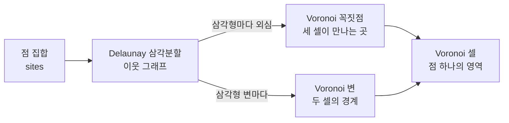

## 1. 왜 Voronoi인가요?

[Fantasy Map Generator 분석 글](/kb/2026-10-19-fantasy-map-generator-architecture)을 쓰면서 Voronoi라는 이름을 계속 만났습니다. FMG는 지도의 모든 셀을 Voronoi 다이어그램으로 만듭니다. 도로망도 그 쌍대인 Delaunay 삼각분할에서 가지를 쳐서 만듭니다. 찾아보니 이 도형은 지도 생성기 밖에서도 자주 나옵니다. 셰이더의 셀룰러 노이즈, Minecraft의 바이옴 경계, Houdini와 Unreal의 파괴 효과, 기지국 커버리지 모델에도 같은 구조가 쓰입니다.

이 글은 왜 하필 Voronoi인지를 정리합니다. 정의와 역사, Delaunay 삼각분할과의 관계를 먼저 봅니다. 이어서 점을 어떻게 뿌려야 하는지, 쓰이는 곳과 쓰이지 않는 곳, 무엇을 조심해야 하는지를 다룹니다. 출처는 가능한 한 논문과 저자 본인의 글로 확인했고 몇 가지는 직접 재 봤습니다.

## 2. 한 문장으로 이해하기

**Voronoi 다이어그램**은 평면에 점(site) 몇 개를 찍었을 때, 평면의 모든 위치를 "가장 가까운 점"에 따라 나눈 그림입니다.

Fortune의 1987년 논문은 이렇게 정의합니다.

> The Voronoi region of a site s is the set of points in the plane for which s is the closest site among all the sites.

두 점 사이의 경계는 두 점을 잇는 선분의 수직이등분선 위에 놓입니다. 그래서 셀은 항상 볼록다각형이고 셀 세 개가 만나는 꼭짓점은 세 점에서 같은 거리에 있는 점, 곧 세 점을 지나는 원의 중심(외심)입니다.

| 질문                    | 답                                                                                                        |
| ----------------------- | --------------------------------------------------------------------------------------------------------- |
| 입력은 무엇인가요?      | 점 집합 하나입니다. 다른 정보는 필요 없습니다.                                                            |
| 결과는 무엇인가요?      | 셀(영역), 변(경계), 꼭짓점(세 셀이 만나는 곳)입니다. 이웃 관계는 쌍대인 Delaunay 삼각분할이 알려 줍니다.  |
| 얼마나 빠른가요?        | O(n log n)에 만들 수 있습니다. 이 글에서 잰 Delaunator는 100만 점을 0.37초에 삼각분할했습니다.            |
| 모양을 무엇이 정하나요? | 점을 어떻게 뿌리느냐입니다. 균등 난수, 지터 격자, Poisson disk, Lloyd 완화에 따라 결과가 크게 달라집니다. |
| 다른 이름은요?          | Dirichlet tessellation, Thiessen 다각형, Wigner–Seitz 셀이 모두 같은 구조입니다.                          |

## 3. 기존 글과의 관계

| 대상                                                                                     | 관계                                                                                                                                                                                                           |
| ---------------------------------------------------------------------------------------- | -------------------------------------------------------------------------------------------------------------------------------------------------------------------------------------------------------------- |
| [Fantasy Map Generator 아키텍처 분석](/kb/2026-10-19-fantasy-map-generator-architecture) | 이 글의 출발점입니다. FMG의 지터 격자, 외심으로 만드는 Voronoi 꼭짓점, 지도 밖 경계 점, Urquhart 그래프 도로망이 모두 이 글에서 다루는 기법입니다. 그 글을 먼저 읽으면 왜 이런 선택을 했는지가 더 잘 보입니다. |

## 4. 같은 규칙이 여러 번 발견됐습니다

"가장 가까운 점으로 나누기"는 단순한 규칙이라 여러 분야에서 각자 발견했고 이름도 여럿입니다.

| 연도 | 누가               | 무엇을                                                                                                                                       |
| ---: | ------------------ | -------------------------------------------------------------------------------------------------------------------------------------------- |
| 1644 | Descartes          | 『철학의 원리』에서 별마다 소용돌이가 공간을 나누는 그림을 그렸습니다. 개념을 정의하지는 않았으므로 "Voronoi를 닮은 그림" 정도가 정확합니다. |
| 1850 | Dirichlet          | 2차 형식 연구에서 이 분할을 썼습니다. "Dirichlet tessellation"이라는 이름이 여기서 왔습니다. Gauss가 1840년에 먼저 관찰했습니다.             |
| 1908 | Georgy Voronoi     | n차원으로 일반화하고 격자의 쌍대 분할까지 다뤘습니다. 지금 가장 널리 쓰는 이름입니다.                                                        |
| 1911 | Alfred H. Thiessen | 기상학에서 우량계마다 담당 면적을 나눠 넓은 지역의 평균 강수량을 구했습니다. "Thiessen 다각형"이라는 이름은 1917년에 Horton이 붙였습니다.    |
| 1933 | Wigner, Seitz      | 금속 나트륨 결정 연구에 썼습니다. 고체물리에서는 지금도 Wigner–Seitz 셀이라고 부릅니다.                                                      |
| 1934 | Boris Delaunay     | 빈 원 조건을 써서 쌍대 삼각분할을 불규칙하게 놓인 점으로 확장했습니다. Voronoi에게 헌정한 논문입니다.                                        |
| 1975 | Shamos, Hoey       | 계산기하학에 Voronoi 다이어그램을 들여와 O(n log n) 분할정복 알고리즘을 제시했습니다.                                                        |
| 1996 | Steven Worley      | 같은 분할을 텍스처 함수로 바꾼 셀룰러 노이즈를 발표했습니다.                                                                                 |

### John Snow의 콜레라 지도는 Voronoi일까요?

1854년 런던 콜레라 지도는 "최초의 Voronoi 다이어그램 활용"으로 자주 소개됩니다. 1차 자료를 보면 조금 다릅니다.

- 유명한 첫 지도에는 경계선이 없습니다. 점선은 1855년 교구 조사 보고서에 실린 **두 번째 지도**에 있습니다.
- 점선은 Broad Street 펌프 주변 **셀 하나**만 둘러쌉니다. 모든 펌프에 대한 분할이 아닙니다.
- Snow는 이 선을 "가장 가까운 길로 잰 거리가 같은 지점들(at an equal distance by the nearest road)"이라고 설명했습니다. 직선거리가 아니라 **길을 따라 걷는 거리**입니다.

따라서 도로망 거리로 그린, Voronoi와 비슷한 경계 하나로 보는 것이 정확합니다. Voronoi라는 이름은 그로부터 약 50년 뒤에 나왔습니다.

## 5. 점 하나에서 그래프 세 개가 나옵니다

### 5.1 Delaunay 삼각분할과의 쌍대 관계

Voronoi 셀 두 개가 변을 공유하면 두 점을 선분으로 잇습니다. 이렇게 이은 선분 전체가 **Delaunay 삼각분할**입니다. Delaunay가 1934년에 정의한 조건은 이렇습니다.

> the circumcircle of each triangle is empty of other sites.

삼각형마다 세 꼭짓점을 지나는 원(외접원)을 그렸을 때 그 안에 다른 점이 없어야 합니다. 그 원의 중심(외심)이 Voronoi 꼭짓점입니다. 외심은 세 점에서 거리가 같은데 원이 비어 있으니 그보다 가까운 점도 없습니다.



이렇게 점 집합 하나에서 서로 연결된 구조 세 가지가 나옵니다.

| 구조                | 노드              | 절차적 생성에서 쓰는 곳                                          |
| ------------------- | ----------------- | ---------------------------------------------------------------- |
| Delaunay 삼각분할   | 점(셀 중심)       | 이웃 탐색, flood fill, Dijkstra 확장, 길찾기                     |
| Voronoi 변과 꼭짓점 | 꼭짓점(셀 모서리) | 국경, 해안선 그리기, 강 경로. 꼭짓점마다 이웃이 정확히 셋입니다. |
| Voronoi 셀          | 영역              | 지역, 국가, 바이옴처럼 "어디에 속하는가"를 담는 단위             |

Amit Patel은 2010년 글 "Polygonal Map Generation for Games"에서 이 두 그래프를 함께 썼습니다. 길찾기에는 셀 그래프를 쓰고 경계와 강은 꼭짓점 그래프로 처리했습니다. 글의 출발점은 이 질문이었습니다.

> What could I do with 1,000 polygons instead of 1,000,000 tiles?

Martin O'Leary의 판타지 지도 생성기(@unchartedatlas)는 계산을 아예 Voronoi 꼭짓점 위에서 합니다. 이유는 "노드마다 이웃 수가 셋으로 고정되어 코드 일부가 쉬워지기 때문"이라고 적었습니다.

### 5.2 Delaunay가 좋은 삼각분할인 이유

같은 점 집합을 삼각형으로 나누는 방법은 많습니다. Delaunay 삼각분할은 그중 **가장 작은 각을 최대로 만드는** 분할입니다(Lawson, Sibson). 삼각형이 뾰족하고 길쭉하면 외심이 삼각형 밖으로 멀리 떨어져 Voronoi 변이 아주 짧거나 아주 길어집니다. 삼각형의 각이 고르면 셀 모양도 고르게 나옵니다.

### 5.3 코드로 보면

Delaunator는 삼각분할을 half-edge 배열 두 개로 돌려줍니다. 공식 가이드의 Voronoi 만들기는 이 정도 분량입니다.

```js
const delaunay = Delaunator.from(points)
// 삼각형 t는 half-edge 3t, 3t+1, 3t+2를 갖습니다
const triangleOfEdge = (e) => Math.floor(e / 3)
const nextHalfedge = (e) => (e % 3 === 2 ? e - 2 : e + 1)

// 점 p로 들어오는 half-edge를 따라 돌며 이웃 삼각형의 외심을 모으면 p의 셀입니다
function edgesAroundPoint(start) {
  const result = []
  let incoming = start
  do {
    result.push(incoming)
    incoming = delaunay.halfedges[nextHalfedge(incoming)]
  } while (incoming !== -1 && incoming !== start)
  return result
}
```

`halfedges[e]`가 `-1`이면 반대편 삼각형이 없다는 뜻입니다. 볼록 껍질에 걸친 바깥 셀은 무한히 뻗기 때문에 이 루프가 중간에 멈춥니다. FMG가 지도 바깥에 경계 점을 한 바퀴 둘러 두는 것도 이 때문입니다. 이 점들 몫의 셀은 만들지 않습니다.

### 5.4 Delaunay 안에 숨은 그래프들

Delaunay 삼각분할에서 간선을 덜어 내면 더 성긴 근접 그래프들이 나옵니다. 포함 관계는 이렇습니다.

```text
Delaunay ⊇ Gabriel ⊇ RNG(상대 이웃 그래프) ⊇ EMST(유클리드 최소 신장 트리)
```

FMG의 도로망은 **Urquhart 그래프**입니다. Delaunay 삼각형마다 가장 긴 변을 지운 그래프로, Urquhart가 1980년에 RNG를 빨리 구하는 방법으로 제안했습니다. 뒤에 RNG와 정확히 같지는 않다는 것이 밝혀졌지만 좋은 근사이고 EMST를 포함하므로 항상 연결되어 있습니다. 가까운 도시끼리만 잇고 먼 도시는 중간 도시를 거쳐 가는 도로망이 이렇게 나옵니다.

## 6. 직접 만져 보기

아래 실험실은 이 글을 위해 만든 것입니다. 점을 뿌린 뒤 Bowyer–Watson 알고리즘으로 Delaunay 삼각분할을 만들고 외심을 이어 Voronoi 셀을 구성해 화면 크기로 자릅니다. 모두 브라우저 안에서 계산합니다. 셀에 마우스를 올리면 그 셀의 이웃과 외접원이 보입니다. 외접원 안에 다른 점이 하나도 없다는 것을 직접 확인할 수 있습니다.

<VoronoiLab lang="ko" />

## 7. 모양을 정하는 것은 점 분포입니다

Voronoi 알고리즘 자체에는 조절할 매개변수가 없습니다. 결과의 인상은 거의 전부 점을 어떻게 뿌리느냐에서 나옵니다.

### 7.1 네 가지 방법

**균등 난수**는 생각보다 뭉칩니다. Amit Patel은 "난수는 사람들이 기대하는 것보다 뭉친다(Random numbers are more 'clumpy' than what people expect)"고 썼습니다. 뭉친 곳에는 작은 셀이, 빈 곳에는 큰 셀이 생깁니다.

**지터 격자**는 정사각형 격자의 점을 칸 안에서 조금씩 흔듭니다. FMG가 쓰는 방법입니다. O(n)이고 칸 번호만으로 근처 점을 찾을 수 있습니다. 셰이더의 셀룰러 노이즈도 타일마다 점 하나를 두는 지터 격자를 써서 픽셀마다 주변 9칸만 확인합니다. 정작 Worley는 1996년 논문에서 "격자점을 흔들어도 바탕 격자 때문에 이상한 패턴이 생길 수 있다"며 격자 대신 칸마다 Poisson 분포 개수의 점을 뿌렸습니다.

**Poisson disk 샘플링**은 모든 점 사이 거리가 r 이상이 되게 뿌립니다. Bridson이 2007년에 낸 방법은 O(N)이고 반복 계산이 필요 없습니다. 활성 점 주변 r~2r 고리에서 후보를 30개까지 뽑아 보고 자리가 없으면 그 점을 비활성으로 돌립니다. Red Blob Games의 mapgen4가 이 방법을 씁니다.

**Lloyd 완화**는 이미 뿌린 점을 다듬습니다. 각 점을 자기 셀의 무게중심으로 옮기고 다시 Voronoi를 만드는 일을 반복합니다. Bell Labs의 Lloyd가 1957년 학회에서 처음 발표하고 1982년에 논문으로 낸 양자화 방법입니다. 데이터 분석에서 쓰는 k-means와 같은 알고리즘이기도 합니다.

### 7.2 직접 재 봤습니다

위 실험실에서 시드 `2026`, 점 약 260개로 잰 값입니다. **면적 CV**는 셀 면적의 표준편차를 평균으로 나눈 값으로, 작을수록 셀 크기가 고릅니다. **최소 간격**은 이웃한 두 점 사이 거리의 최솟값입니다.

| 분포         | Lloyd 0회 CV |  1회 |  2회 |  5회 | 10회 | 최소 간격 (0회 → 10회) |
| ------------ | -----------: | ---: | ---: | ---: | ---: | ---------------------: |
| 균등 난수    |         0.54 | 0.38 | 0.31 | 0.22 | 0.16 |         1.5px → 28.0px |
| 지터 격자    |         0.22 | 0.15 | 0.12 | 0.08 | 0.07 |         8.1px → 38.1px |
| Poisson disk |         0.22 | 0.17 | 0.15 | 0.12 | 0.10 |        36.6px → 33.4px |

표에서 읽을 수 있는 점은 다음과 같습니다.

1. 지터 격자와 Poisson disk는 아무 반복 없이도 균등 난수에 Lloyd를 5회 돌린 것만큼 고릅니다(CV 0.22).
2. Lloyd는 처음 한두 번이 가장 잘 듣습니다. 균등 난수의 CV가 1회에 0.54에서 0.38로, 2회에 0.31로 떨어진 뒤로는 천천히 줄어듭니다.
3. 지터 격자의 최소 간격은 8.1px로 Poisson disk의 36.6px보다 훨씬 작습니다. 이웃한 두 칸에서 점이 서로 가까운 쪽으로 흔들리면 붙을 수 있기 때문입니다. 셀 크기는 고르지만 가끔 아주 작은 변이 생깁니다.

### 7.3 Lloyd 완화의 한계: 정육각형으로 수렴

Lloyd를 끝까지 반복하면 점이 자기 셀의 무게중심과 일치하는 상태, 곧 **중심 Voronoi 분할(CVT)**에 가까워집니다. Du, Faber, Gunzburger의 1999년 정리에 따르면 2차원에서 최적 CVT의 셀은 정육각형에 가까워집니다. 이것은 Gersho의 추측으로, 2차원에서는 증명되어 있습니다. 벌집처럼 정육각형이 되면 애초에 Voronoi를 쓴 이유였던 불규칙한 느낌이 사라집니다.

그래서 지도 생성기들은 일찍 멈춥니다. Amit Patel은 "두 번 돌리면 결과가 좋다"고 했고 O'Leary는 속도를 이유로 한 번만 돌렸고 2017년의 Azgaar는 무작위 점에 Lloyd를 한 번 적용하면서 "더 반복할 필요는 없다고 본다"고 적었습니다. 지금의 FMG는 지터 격자로 바꿔서 완화를 아예 하지 않습니다.

## 8. 계산 비용

### 8.1 알고리즘 계보

|      연도 | 알고리즘                  | 방식                                                                              | 복잡도                      |
| --------: | ------------------------- | --------------------------------------------------------------------------------- | --------------------------- |
|      1975 | Shamos, Hoey              | 분할정복                                                                          | O(n log n)                  |
|      1981 | Bowyer, Watson            | 점을 하나씩 넣고, 외접원 안에 새 점이 들어간 삼각형을 지운 뒤 빈 자리를 다시 채움 | 보통 O(n log n), 최악 O(n²) |
| 1986~1987 | Fortune                   | 포물선 호로 이루어진 beach line을 쓰는 스윕 라인                                  | O(n log n), 공간 O(n)       |
|      2006 | Rong, Tan (Jump Flooding) | GPU 픽셀 격자에서 거리를 반씩 줄여 가며 전파하는 근사                             | log₂N 패스                  |
|      현재 | Delaunator (Mapbox)       | 볼록 껍질을 넓혀 가는 스윕 + 변 뒤집기, Shewchuk의 견고한 술어                    | 실측 기준 거의 선형         |

JavaScript 생태계도 같은 길을 걸었습니다. d3-voronoi는 Fortune 알고리즘을 구현했고 지금은 Delaunator 기반의 d3-delaunay로 대체되었습니다. d3-voronoi의 폐기 안내는 d3-delaunay가 "5~10배 빠르고 수치적으로 더 견고하다"고 적고 있습니다. FMG도 2017년 첫 블로그 글에서는 d3-voronoi와 Lloyd 완화를 썼고 지금은 지터 격자와 Delaunator를 씁니다. 실험실에 쓴 Bowyer–Watson은 짧고 이해하기 쉽지만 점 수천 개를 넘으면 느려서 실무에서는 Delaunator 같은 라이브러리를 씁니다.

### 8.2 Delaunator를 직접 재 봤습니다

FMG가 쓰는 Delaunator 5.1.0으로 점을 삼각분할해 걸린 시간입니다. 5회 측정의 중앙값입니다.

|     점 수 | 균등 난수 | 지터 격자 | 정사각형 격자 |
| --------: | --------: | --------: | ------------: |
|    10,000 |     3.2ms |     1.8ms |         2.8ms |
|   100,000 |    28.4ms |    22.8ms |        20.1ms |
| 1,000,000 |   370.9ms |   270.5ms |       244.5ms |

README에 적힌 2017년형 MacBook Pro 기준 수치(10만 점 82ms, 100만 점 1.07초)보다 약 세 배 빠릅니다. 10만 셀짜리 지도도 삼각분할은 30ms 안에 끝납니다. FMG 분석 글에서 10만 포인트 지도의 `grid` 단계는 93.5ms였습니다. 삼각분할이 20ms 남짓이니, 그 단계의 나머지 시간은 점을 만들고 Voronoi 셀 구조를 꾸리는 데 쓰인 것으로 보입니다.

### 8.3 이웃은 평균 6개, 분포는 점 배치에 따라 다릅니다

평면 Voronoi에서 셀의 평균 이웃 수는 오일러 공식 때문에 6을 넘지 못합니다. 셀이 많아질수록 내부 셀의 평균은 6에 다가갑니다. 위 측정에서 내부 점의 평균 이웃 수는 모든 경우에 5.99~6.00이었습니다. 평균은 같아도 분포는 다릅니다(10만 점, 내부 점 기준).

| 이웃 수   |    3 |     4 |     5 |     6 |     7 |    8 |    9 |   10 |
| --------- | ---: | ----: | ----: | ----: | ----: | ---: | ---: | ---: |
| 균등 난수 | 1.1% | 10.8% | 26.0% | 29.3% | 19.8% | 8.9% | 3.0% | 0.8% |
| 지터 격자 |    · |  4.6% | 27.1% | 39.2% | 22.8% | 5.6% | 0.5% |    · |

균등 난수는 이웃이 3개인 셀부터 10개인 셀까지 넓게 퍼지고 지터 격자는 6개 근처로 모입니다. 셀마다 이웃 수가 다르니 "이웃 4개" 같은 가정은 코드에 넣을 수 없습니다. 이웃 목록은 가변 길이 배열로 다뤄야 합니다.

정사각형 격자의 진짜 Voronoi 셀은 정사각형이라 이웃이 4개여야 합니다. 그런데 Delaunator는 점마다 이웃을 6개(99.4%) 돌려줬습니다. 정사각형의 네 꼭짓점은 한 원 위에 있어서 어느 대각선으로 나눠도 Delaunay 조건을 만족하고 라이브러리가 그중 하나를 고르기 때문입니다. 이 대각선 이웃은 실제로는 이웃이 아니고 길이가 0인 Voronoi 변을 공유할 뿐입니다. 지터를 주면 이런 동률이 깨집니다.

## 9. 어디에 쓰이나요?

### 9.1 지도 생성

| 프로젝트                                  | 점 분포                      | Voronoi를 쓰는 방식                                                                            |
| ----------------------------------------- | ---------------------------- | ---------------------------------------------------------------------------------------------- |
| Amit Patel, polygon map generation (2010) | 무작위 + Lloyd 2회           | 셀 그래프로 길찾기, 꼭짓점 그래프로 강과 경계. 셀 경계에는 "noisy edge"를 입힙니다.            |
| Red Blob Games mapgen4 (2018)             | Poisson disk                 | Delaunator로 삼각분할한 메시 위에서 지형과 강을 계산합니다.                                    |
| Martin O'Leary, @unchartedatlas (2016)    | 무작위 + Lloyd 1회, 16,384점 | Voronoi 꼭짓점 위에서 지형과 강을 계산합니다(이웃이 항상 셋).                                  |
| Azgaar FMG 초기 (2017)                    | 무작위 + Lloyd, d3-voronoi   | O'Leary의 글에서 영감을 받았습니다. "육각형이나 규칙적인 구조는 그럴듯하지 않다"고 적었습니다. |
| Azgaar FMG 현재 (2026)                    | 지터 격자, Delaunator        | 셀 위에서 지형·기후·국가를 만들고, 도시 사이 도로는 Urquhart 그래프로 냅니다.                  |

Amit Patel의 2022년 튜토리얼에는 이런 문장이 있습니다.

> one of the main reasons to use Voronoi is to break up the regular grid lines.

O'Leary도 같은 이유를 들었습니다. 규칙적인 격자를 쓰면 "이상한 인공물이 생기기 쉽고", 불규칙한 셀을 쓰면 "완성된 지도에 거슬리는 직선 인공물이 남을 걱정이 없다"고 설명했습니다.

### 9.2 셀룰러 노이즈

Steven Worley는 1996년 SIGGRAPH 논문에서 Voronoi를 텍스처 함수로 바꿨습니다. 공간에 특징점을 뿌리고 각 위치에서 가장 가까운 점까지의 거리 F1, 두 번째로 가까운 점까지의 거리 F2를 값으로 씁니다. F1을 쓰면 셀마다 둥근 무늬가 생깁니다. F2−F1은 두 거리가 같아지는 Voronoi 경계에서 0이 되므로 경계를 따라 잎맥 같은 능선이 그려집니다. 논문은 이 함수로 판석, 울퉁불퉁한 생물 피부, 구겨진 종이, 얼음, 바위, 산맥을 만들었습니다. 지금은 Blender의 Voronoi Texture 노드와 Unity Shader Graph의 Voronoi 노드가 이 함수를 그대로 제공합니다. 위 실험실의 "Worley F1", "Worley F2−F1"이 같은 점 집합으로 그린 결과입니다.

### 9.3 그 밖의 쓰임

- **Minecraft 바이옴**: 1.14까지 바이옴 레이어의 마지막 단계는 4×4 블록 칸의 네 모서리에 지터를 준 점을 하나씩 두고 블록마다 가장 가까운 점의 바이옴을 가져왔습니다. 지터 격자 Voronoi로 계단 모양 경계를 흐트러뜨린 것입니다. 1.15부터는 3차원 조회 방식으로 바뀌었고 1.18 이후에도 쓰입니다. 이 내용은 Mojang 코드가 아니라 시드 탐색 커뮤니티의 재구현인 Cubiomes에서 확인했습니다.
- **파괴 효과**: Houdini의 Voronoi Fracture, Unreal Chaos의 Uniform·Cluster·Radial 파쇄, Blender의 Cell Fracture가 모두 Voronoi 분할로 물체를 조각냅니다. Blender 코드에는 Voronoi라는 단어가 나오지 않습니다. 그래도 조각마다 이웃 점과의 수직이등분면으로 공간을 잘라 만들기 때문에 하는 일은 Voronoi 셀 계산과 같습니다.
- **국경 렌더링**: Paradox의 Imperator: Rome은 국경 그라디언트에 쓸 거리장을 GPU의 Jump Flooding 알고리즘으로 계산합니다. 생성이 아니라 그리기 단계에 쓰는 예입니다.
- **기지국 커버리지**: 단말이 가장 가까운 기지국에 붙는다고 보면 커버리지는 Voronoi 셀입니다. Andrews 등(2011)은 기지국을 무작위로 놓은 모델은 실제보다 비관적이고 격자로 놓은 모델은 낙관적이라고 했습니다. 지도 생성에서 균등 난수와 격자 사이에서 고민하는 것과 같은 구도입니다.

### 9.4 Voronoi가 아닌 것

- **Townscaper**: 불규칙한 격자가 Voronoi처럼 보이지만 아닙니다. Oskar Stålberg는 정삼각형 격자에서 삼각형을 무작위로 짝지어 사각형을 만들고 모두 사각형으로 쪼갠 뒤 완화한다고 설명했습니다. 타일 세트가 사각형을 전제로 하기 때문에 모든 셀에 이웃이 넷씩 오도록 맞췄습니다.
- **자연의 무늬**: 잠자리 날개 맥, 기린 무늬, 자이언츠 코즈웨이의 주상절리는 Voronoi와 **닮았습니다**. 잠자리 날개는 2018년 PNAS 모델에서 "고르게 놓인 점의 Voronoi 분할과 눈에 띄게 비슷하다"는 정도이고 주상절리는 식으면서 생긴 균열이 "거의 육각형"으로 자란 결과입니다. 겉모습은 닮았지만 가장 가까운 씨앗에서 자란 것은 아니므로 메커니즘은 다릅니다.
- Dwarf Fortress, Civilization, Europa Universalis가 Voronoi로 지도를 만든다는 이야기는 1차 자료에서 확인하지 못했습니다.

## 10. 왜 절차적 생성에 잘 맞을까요?

1. **이웃 관계가 공짜로 나옵니다.** Delaunay 삼각분할이 곧 인접 그래프라서 flood fill, Dijkstra 확장, 길찾기를 바로 돌릴 수 있습니다. FMG의 언덕 만들기(BFS)와 국가 확장(Dijkstra)이 이 그래프 위에서 돌아갑니다.
2. **영역, 경계, 모서리가 한 번에 나옵니다.** 셀은 국가와 바이옴을, 변은 국경과 해안선을, 꼭짓점은 강이 흐르는 길을 담습니다.
3. **크기는 고르고 모양은 불규칙합니다.** 지터 격자, Poisson disk, 한두 번의 Lloyd 완화로 셀 크기를 고르게 맞추면서도 격자의 직선을 없앨 수 있습니다.
4. **경계가 자연스럽습니다.** 두 씨앗에서 같은 거리에 경계를 긋는 규칙은 결정이 자라며 맞닿는 방식, 우량계의 담당 구역, 가장 가까운 시설의 서비스 범위와 같습니다.
5. **벡터로 그릴 수 있습니다.** 셀이 다각형이라 SVG 경로로 바로 그릴 수 있고 점 수를 바꾸면 해상도가 바뀝니다.
6. **충분히 빠릅니다.** 100만 점 삼각분할이 0.4초 안팎입니다.

## 11. 주의할 점

1. **바깥 셀은 무한히 뻗습니다.** 볼록 껍질에 걸친 셀은 닫히지 않습니다. 지도 밖에 경계 점을 두르거나(FMG), 사각형으로 잘라야 합니다(d3-delaunay). 실험실에서는 경계 점을 너무 가까이 두면 점이 성긴 곳에서 바깥 점의 이등분선이 지도 안으로 들어와 구멍이 생겼습니다.
2. **외심은 삼각형 밖으로 나갈 수 있습니다.** 길쭉한 삼각형은 아주 짧거나 아주 긴 Voronoi 변을 만듭니다. Amit Patel은 2017년에 외심 대신 무게중심을 써서 이 문제를 피하는 방법을 정리했습니다. 대신 셀이 볼록하지 않을 수 있습니다.
3. **규칙적인 점은 오히려 위험합니다.** 한 원 위에 네 점이 놓이면 삼각분할이 하나로 정해지지 않습니다. 8.3절의 정사각형 격자처럼 결과가 라이브러리의 선택에 좌우됩니다. 부동소수 오차까지 생각하면 Delaunator처럼 견고한 기하 술어를 쓰는 구현을 고르는 것이 좋습니다.
4. **이웃 수가 일정하지 않습니다.** 정사각형이나 육각형 격자처럼 이웃 수를 가정할 수 없어서 자료구조와 코드가 복잡해집니다. Amit Patel도 "Voronoi는 구현 복잡도를 꽤 높이기 때문에 대부분의 프로젝트에서는 정사각형이나 육각형 격자를 쓴다"고 적었습니다.
5. **좌표로 셀을 찾으려면 검색이 필요합니다.** 임의의 좌표가 어느 셀에 속하는지 알려면 가장 가까운 점을 찾아야 합니다. FMG의 지터 격자는 칸 번호로 바로 찾지만 셀 경계 근처에서는 실제로 가장 가까운 점과 다를 수 있는 근사입니다.
6. **Lloyd 완화를 과하게 반복하면 셀이 정육각형에 가까워집니다.** 한두 번에서 멈추는 편이 좋습니다(7.3절).

## 12. 결론

Voronoi 다이어그램은 "가장 가까운 점으로 나눈다"는 규칙 하나로 영역, 경계, 이웃 그래프를 함께 줍니다. 지도 생성기는 이 셀 위에서 지형과 국가를 키웁니다. 셰이더는 같은 거리 함수로 돌과 세포 무늬를 그리고 물리 엔진은 같은 분할로 물체를 부숩니다. 결과물이 어떤 인상을 주는지는 알고리즘보다 점을 어떻게 뿌리느냐에 달렸습니다. 직접 재 보니 지터 격자와 Poisson disk는 반복 없이도 셀 크기 편차가 균등 난수의 절반 이하였습니다. Lloyd 완화는 한두 번 돌렸을 때 효과가 가장 컸습니다.

---

> 조사 일자: 2026-10-19
> 측정 환경: Apple M5 Pro, macOS, Node 24.15, Delaunator 5.1.0(FMG `b4a0dcb`의 의존성), 5회 측정 중앙값. 실험실 수치는 이 글의 VoronoiLab 컴포넌트, 시드 `2026`, 점 약 260개, 960×540 영역

### 참고 자료

- S. Fortune, "A sweepline algorithm for Voronoi diagrams", Algorithmica 2 (1987)
- F. Aurenhammer, "Voronoi diagrams: a survey of a fundamental geometric data structure", ACM Computing Surveys 23(3) (1991)
- T. Liebling, L. Pournin, "Voronoi Diagrams and Delaunay Triangulations: Ubiquitous Siamese Twins", Documenta Mathematica Extra Volume ISMP (2012)
- A. Bowyer, "Computing Dirichlet tessellations" / D. F. Watson, "Computing the n-dimensional Delaunay tessellation", The Computer Journal 24(2) (1981)
- M. I. Shamos, D. Hoey, "Closest-point problems", FOCS (1975)
- R. B. Urquhart, "Algorithms for computation of relative neighbourhood graph", Electronics Letters 16(14) (1980)
- R. Bridson, "Fast Poisson Disk Sampling in Arbitrary Dimensions", SIGGRAPH sketch (2007)
- S. P. Lloyd, "Least squares quantization in PCM", IEEE Trans. Inf. Theory 28(2) (1982)
- Q. Du, V. Faber, M. Gunzburger, "Centroidal Voronoi Tessellations: Applications and Algorithms", SIAM Review 41(4) (1999)
- S. Worley, "A Cellular Texture Basis Function", SIGGRAPH (1996)
- G. Rong, T.-S. Tan, "Jump flooding in GPU with applications to Voronoi diagram and distance transform", I3D (2006)
- [Delaunator](https://github.com/mapbox/delaunator)와 [Delaunator guide](https://mapbox.github.io/delaunator/), [d3-delaunay](https://d3js.org/d3-delaunay/voronoi)
- Amit Patel, [Polygonal Map Generation for Games](http://www-cs-students.stanford.edu/~amitp/game-programming/polygon-map-generation/) (2010), [Voronoi maps tutorial](https://www.redblobgames.com/x/2022-voronoi-maps-tutorial/) (2022), [mapgen4](https://www.redblobgames.com/maps/mapgen4/)
- Martin O'Leary, [Generating fantasy maps](https://web.archive.org/web/2023/https://mewo2.com/notes/terrain/) (2016)
- Azgaar, [Voronoi graph](https://azgaar.wordpress.com/2017/03/30/voronoi-graph/) (2017)
- [Cubiomes](https://github.com/Cubitect/cubiomes) (Minecraft 바이옴 생성 재구현)
- [Houdini Voronoi Fracture](https://www.sidefx.com/docs/houdini/nodes/sop/voronoifracture.html), [Unreal Chaos fracturing](https://dev.epicgames.com/documentation/en-us/unreal-engine/fracturing-geometry-collections-user-guide), [Imperator: Rome 국경 렌더링](https://www.intel.com/content/www/us/en/developer/articles/technical/optimized-gradient-border-rendering-in-imperator-rome.html)
- J. Andrews, F. Baccelli, R. Ganti, "A Tractable Approach to Coverage and Rate in Cellular Networks", IEEE Trans. Commun. (2011)
- J. Hoffmann, S. Donoughe, K. Li, M. K. Salcedo, C. H. Rycroft, [PNAS 115(40):9905–9910](https://pmc.ncbi.nlm.nih.gov/articles/PMC6176563) (2018), insect wing venation model
- [R cholera 패키지 README](https://cran.r-project.org/web/packages/cholera/readme/README.html) (John Snow 지도의 점선 설명)

_Claude Code와 함께 작성됨_
