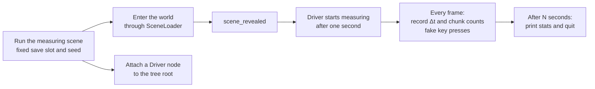

## 1. The symptom

Pungsu Keeper is a 2D top-down survival crafting game I am building in Godot 4.6. The world is split into chunks of 64×64 tiles, and the 7×7 chunks (49 of them) around the hero are kept loaded. When the hero crosses a chunk border, the seven chunks in the new row ahead are built and the ones left behind are unloaded.

[](/static/images/pungsu-stutter/game.webp)

The playtest feedback was that the game visibly stuttered after walking for a bit. Most of the time it was fine, then it froze for more than a tenth of a second, several times in a row.

The obvious guess was "chunk loading is heavy", and I wanted to go straight in and fix it. But fixing by guess is a good way to fix the wrong thing. So the first step was **a measuring tool that reproduces the same situation as many times as needed**.

## 2. Building the measuring harness

### 2.1 Requirements

- Nobody has to walk by hand. The hero moves along a fixed route on their own, so the same situation can be replayed.
- It enters the world the way the game does. The game prepares the world behind a loading screen (`SceneLoader`), so the harness takes the same path.
- It actually renders. A headless run leaves out rendering cost, so measurements run in a window.
- Vertical sync is off. Locked to 60 fps, every frame faster than 16.7 ms would read as 16.7 ms.
- Results are a few numbers. An average hides stutter, so p95, p99, the maximum, and the counts of frames over 33, 50 and 100 ms are reported together.
- Every stutter keeps its context. Each spike records how many chunks were loaded and how many were waiting at that moment, which narrows down the cause.

### 2.2 How it fits together



The measuring scene itself does very little. It fixes the save slot and the world seed and enters the world exactly as the game does, through `SceneLoader.change_scene()`. Changing scenes frees the measuring scene, so the actual measuring is done by a `Driver` node attached directly to the scene tree root. Children of the root survive a scene change.

```gdscript
func _ready() -> void:
	SaveManager.current_slot = 5          # a slot reserved for measuring
	GameState.reset_for_tutorial_start()
	GameState.world_seed = 777            # the same terrain every time
	GameState.set_story_flag("intro_seen", true)
	var driver := Driver.new()
	get_tree().root.add_child.call_deferred(driver)   # survives the scene change
	SceneLoader.change_scene.call_deferred("res://scenes/world/world.tscn")
```

The `Driver` runs with `PROCESS_MODE_ALWAYS` so it keeps going while the loading screen pauses the tree. It waits for the signal that the loading screen has gone (`scene_revealed`), waits one more second, then starts. Every frame it measures the frame time from `Time.get_ticks_usec()` and fakes key presses so the hero walks right, down, left and up, switching every three seconds.

```gdscript
func _process(_delta: float) -> void:
	var now := Time.get_ticks_usec()
	var dt := (now - last_us) / 1000.0
	last_us = now
	t += dt / 1000.0
	var cm = get_tree().current_scene.chunk_manager
	frames.append([t, dt, cm.loaded_chunks.size(), cm.pending_chunk_count()])
	var dirs := ["move_right", "move_down", "move_left", "move_up"]
	var leg := int(t / 3.0) % 4
	for i in 4:
		if i == leg: Input.action_press(dirs[i])
		else: Input.action_release(dirs[i])
	if t >= seconds:
		_report()   # avg, p50/p95/p99, max, counts over 33/50/100 ms, spikes over 50 ms
		get_tree().quit()
```

### 2.3 Modes

The harness takes a mode on the command line. They were not all planned up front; a new one was added each time a new hypothesis came up.

| Mode        | What it does                                                                                                    | Why it exists                                                                                                                |
| ----------- | --------------------------------------------------------------------------------------------------------------- | ---------------------------------------------------------------------------------------------------------------------------- |
| `base`      | Walks, changing direction every three seconds.                                                                  | The baseline.                                                                                                                |
| `nofader`   | Walks with `OcclusionFader` (which makes things in front of the hero see-through) switched off.                 | To compare with a suspect system off and on (A/B).                                                                           |
| `chunkcost` | Builds faraway chunks directly, timing ground, props (trees, rocks, grass), monsters, and the two frames after. | To see where one chunk spends its time.                                                                                      |
| `stripcost` | Builds a chunk one strip at a time, timing the script and the following frame for each strip.                   | To tell whether the stutter left after the fix was script time or engine time.                                               |
| `glideN`    | Turns collision off and slides the hero in one direction at N pixels per second.                                | Walking, the hero hit a village fence or forest within seconds in every direction. Sliding crosses about ten chunks in 45 s. |

The last mode came from trying the others. At first the harness simply ran in a straight line, but the hero got stuck on a fence or a forest within a few seconds whichever way they went. Collecting many chunk-border crossings meant turning collision off and moving the hero directly.

### 2.4 Lessons from using it

- **Do nothing else while measuring.** Partway through, macOS background processes took over the CPU and pushed the load average to 7. The numbers from that run did not add up, and I threw them away.
- **Interleave comparisons.** When comparing two versions, running them A, B, A, B means a change in system load does not hit only one side. For this I added a temporary switch to the code for the duration of the measurement and removed it afterwards.
- **Measure the old code with the same harness.** I checked out the commit before the fix into a separate git worktree and copied only the harness files in. That keeps the conditions of the before-and-after table identical.

## 3. Root causes

### 3.1 Scanning 19,000 nodes every physics tick

The `nofader` mode gave the first clue. Walking the same route:

| Run       | Average frame | Max      |
| --------- | ------------- | -------- |
| `base`    | 14.6 ms       | 134.3 ms |
| `nofader` | 8.5 ms        | 78.1 ms  |

One feature, making things see-through, was costing 6 ms a frame on average. Calling its two halves 20 times each from the harness made the cause obvious.

```text
> occluding_layer=2 occluder=19142
> fade_layers 0.00ms fade_nodes 4.34ms per call
```

To find trees or entrances standing in front of the hero, `OcclusionFader` walked the whole group with `get_nodes_in_group("occluder")` every physics tick. That group held every tree, rock and tuft of grass in the 49 loaded chunks, **19,142 nodes**. Only the few within 96 pixels of the hero ever mattered.

This cost also makes stutters worse. When a frame runs long, Godot runs the physics ticks it owes several times within one frame. After a frame that spent 100 ms building a chunk, this 4 ms scan appears to run several times, so the next frame runs long too. On the old code the frame after building a chunk took 33 to 65 ms; with only this fixed it dropped to 21 to 28 ms.

### 3.2 Building and tearing down a whole chunk in one frame

The spike list from the `base` mode gave the second clue.

```text
>   spike t=9.89s 95.3ms chunks=50 pending=6
>   spike t=9.98s 95.4ms chunks=51 pending=5
>   spike t=10.10s 116.9ms chunks=52 pending=4
>   spike t=10.20s 99.9ms chunks=53 pending=3
>   spike t=10.32s 125.7ms chunks=54 pending=2
>   spike t=10.44s 113.4ms chunks=55 pending=1
>   spike t=10.57s 134.3ms chunks=56 pending=0
```

From the moment the hero crossed a chunk border, the waiting count fell 6, 5, 4 and so on, with a frame over 100 ms each time, seven in a row. The code built one whole chunk per frame. A comment said "about 16 ms per chunk", but terrain overlays and forests had been added since, and the number had changed. The `chunkcost` mode split it up:

| Stage                                                      | Time           |
| ---------------------------------------------------------- | -------------- |
| Laying ground tiles (4,096 cells plus overlays)            | about 18 ms    |
| Creating props (about 350 to 540 trees, rocks, grass)      | about 19–27 ms |
| Engine work in the next frame (registering nodes, drawing) | about 21–28 ms |

A little over 60 ms per chunk, seven times in a row. Unloading the chunks left behind was the same: freeing hundreds of nodes and clearing thousands of tiles for seven chunks at once, which at higher speeds gave freezes of 100 to 330 ms.

The chunks being built sit two or three chunks away from the hero, more than 6,000 pixels. There is plenty of time before they come into view, and no reason to rush them into a single frame.

### 3.3 A suspect that turned out innocent

At first I suspected something else. To draw tree tiles see-through, the `TileMapLayer` overrides `_use_tile_data_runtime_update()`, which makes the engine call a script function for every tile. Tens of thousands of tiles each going through a GDScript call sounded heavy.

I deleted both functions and walked the same route again: 15.7 ms average and 129 ms max, no difference. Without measuring, this is what I would have fixed first.

## 4. The fix

### 4.1 Registering occluders in buckets

Once placed, occluders never move. So instead of scanning the group every tick, each occluder now registers itself in a 128-pixel bucket when it enters the tree and removes itself when it leaves. The fader only looks at the 3×3 buckets around the hero. The 96-pixel reach fits inside one bucket, so nothing in range is missed.

```gdscript
const BUCKET := 128.0
static var _buckets: Dictionary = {}  # Vector2i -> Array[Node2D]

static func track(node: Node2D) -> void:
	node.add_to_group("occluder")
	node.tree_entered.connect(_add.bind(node))
	node.tree_exiting.connect(_remove.bind(node))
	if node.is_inside_tree():
		_add(node)

static func occluders_near(at: Vector2) -> Array[Node2D]:
	var out: Array[Node2D] = []
	var centre := _bucket_of(at)
	for dy in range(-1, 2):
		for dx in range(-1, 2):
			out.append_array(_buckets.get(centre + Vector2i(dx, dy), []))
	return out
```

The scan that took 4.3 ms per call is now too small to measure (under 0.01 ms). At the starting spot, the number of occluders actually checked went from 19,142 to 5.

<OccluderScan lang="en" />

### 4.2 Building chunks a strip per frame

Building a chunk is now split into steps: the ground four rows at a time (16 steps), the props four columns at a time (16 steps), then the monsters. Each frame, `_process` advances these steps within a 4 ms budget.

```gdscript
func _process(_delta: float) -> void:
	var until := Time.get_ticks_usec() + BUILD_BUDGET_USEC   # 4000
	var strips := CHUNK_SIZE / BUILD_STRIP                  # 64 / 4
	while Time.get_ticks_usec() < until:
		if not _unloading.is_empty():
			var job: Dictionary = _unloading[0]
			var frees_props: bool = job["step"] < strips
			if _advance_unload(job):
				_unloading.pop_front()
			if frees_props:
				return
			continue
		if _build.is_empty() and not _start_next_pending():
			return
		var adds_props: bool = _build["step"] >= strips
		if _advance_build(_build):
			_build = {}
		if adds_props:
			return
```

The figure below walks through this order on a real chunk. Switch to "Before" to see the same chunk built in one frame, and how long that frame is.

<ChunkStrips lang="en" />

Splitting it up came with a few rules.

- **The result must not change.** Props were always placed column by column, so splitting by columns keeps the order. A test builds the same chunk in one go and in strips and compares ground tiles, prop positions and monster counts.
- **Build at once when it is urgent.** If a half-built chunk ends up right next to the hero (within one chunk), it is finished on the spot. The first 49 chunks behind the loading screen are also built in one go.
- **A half-built chunk can be unloaded.** If the hero walks away before it is done, what has been built so far is taken down.
- **Unloading also goes in strips.** If the hero comes back to a chunk that is still coming down, the remaining teardown finishes first and then the chunk is rebuilt. Otherwise a late teardown strip would erase freshly built ground.

### 4.3 The engine's share is invisible to the budget

With that, the 100 ms freezes were gone, but running fast still gave frames of 35 to 45 ms. The player noticed too: "it still hitches a little when new ground appears". Timing each strip with the `stripcost` mode showed why.

```text
> (6, 0) terrain x16 script=1.4(max 1.5) frame1=7.7(max 15.5) frame2=6.7
> (6, 0) props   x16 script=1.5(max 2.6) frame1=10.6(max 18.7) frame2=7.0
```

A strip of props takes only 1.5 ms of script, but the next frame runs 3 to 4 ms longer than usual. That is the engine registering 25-odd nodes with the physics server and drawing them. The 4 ms budget only counts script time, so when two or three prop strips land in one frame, this cost stacks.

So a step that creates or frees nodes now ends the frame (`adds_props` and `frees_props` above). The comparison ran both versions alternately in the same working tree.

| 40 s at 320 px/s | Frames over 33 ms | Max      |
| ---------------- | ----------------- | -------- |
| No limit         | 12–13             | 45–47 ms |
| One per frame    | 0–2               | 30–35 ms |

Building is slower now, but even at running speed the waiting chunks did not pile up. If they had, the chunks next to the hero would have been built in one go, bringing the big freezes back.

## 5. Results

The same harness and seed, run alternately on the commit before the fix and the commit after. Windowed with vertical sync off; times are in ms. First, every frame's time as measured; the tabs switch scenarios.

<FrameTimeline lang="en" />

Boiled down to numbers:

| Scenario                                      | Version |  Avg |  p95 |   p99 |   Max | Over 50 ms | Over 100 ms |
| --------------------------------------------- | ------- | ---: | ---: | ----: | ----: | ---------: | ----------: |
| Walking 24 s (turning every 3 s)              | Before  | 12.3 | 22.1 |  23.8 | 107.9 |          7 |           4 |
|                                               | After   |  7.7 | 13.7 |  17.2 |  25.1 |          0 |           0 |
| Straight at 320 px/s for 40 s (running speed) | Before  | 15.7 | 21.9 | 103.4 | 189.6 |         42 |          32 |
|                                               | After   | 10.2 | 17.6 |  20.8 |  28.4 |          0 |           0 |
| Straight at 450 px/s for 40 s                 | Before  | 17.7 | 25.4 | 111.3 | 193.5 |         56 |          49 |
|                                               | After   | 12.4 | 19.9 |  22.4 |  30.1 |          0 |           0 |

<FrameLadder lang="en" />

The average fell by 30 to 40%, but the biggest difference is in the tail: p99 went from just over 100 ms to around 20 ms, and the maximum from about 190 ms to under 30 ms. Stutter is felt in the tail, not the average. This table and these figures are the reference for the before-and-after comparison; the numbers in the earlier sections were measured while narrowing down the causes and differ slightly.

## 6. What is left

- There are still 19,000 prop nodes loaded. Simple things like grass and bushes could be drawn as tiles or with a `MultiMesh` instead of nodes, cutting the engine's share of each chunk itself.
- The harness still lives outside the repository (`tmp_demo/`). Cleaned up to run in CI, it could become a performance regression test, such as "fail if p99 is over 30 ms".
- All of this was measured on one development Mac. The web build and low-end machines need measuring again.
