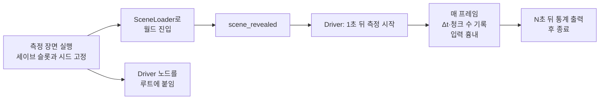

## 1. 증상

풍수지기는 Godot 4.6으로 만들고 있는 2D 탑다운 생존 크래프팅 게임입니다. 월드는 64×64 타일짜리 청크로 나뉘어 있고, 주인공 주변 7×7 청크(49개)를 불러 둡니다. 주인공이 청크 경계를 넘으면 앞쪽 줄의 청크 7개를 새로 짓고, 멀어진 청크는 내립니다.

[](/static/images/pungsu-stutter/game.webp)

게임을 시작하고 조금만 걸어도 화면이 눈에 띄게 끊긴다는 플레이 피드백을 받았습니다. 평소에는 괜찮다가 어느 순간 0.1초 넘게 멈추는 일이 몇 번 연달아 일어났습니다.

"청크 로딩이 무겁겠지" 하고 바로 고치고 싶었지만 짐작으로 고치면 엉뚱한 곳을 고치기 쉽습니다. 그래서 먼저 **같은 조건에서 몇 번이고 다시 잴 수 있는 측정 도구**를 만들었습니다.

## 2. 측정 하네스를 이렇게 만들었습니다

### 2.1 요구 사항

- 사람이 직접 걷지 않아도 됩니다. 주인공이 정해진 경로로 스스로 움직여야 같은 상황을 몇 번이고 재현할 수 있습니다.
- 실제 게임과 같은 길로 들어갑니다. 게임은 로딩 화면(`SceneLoader`) 뒤에서 월드를 준비하니 하네스도 그 경로를 그대로 탑니다.
- 화면을 실제로 그립니다. 헤드리스로 돌리면 렌더링 비용이 빠지므로 창을 띄워서 잽니다.
- 수직 동기화를 끕니다. 60fps에 묶여 있으면 16.7ms보다 빠른 프레임이 모두 16.7ms로 보입니다.
- 숫자 몇 개로 요약합니다. 평균은 끊김을 숨기므로 p95, p99, 최댓값과 33ms·50ms·100ms를 넘은 프레임 수를 함께 봅니다.
- 끊김이 났을 때의 상태를 남깁니다. 스파이크마다 그 순간 불러온 청크 수와 대기 중인 청크 수를 기록하면 원인을 좁히기 쉽습니다.

### 2.2 구조



측정 장면이 하는 일은 단순합니다. 세이브 슬롯과 월드 시드를 고정하고, 게임과 똑같이 `SceneLoader.change_scene()`으로 월드에 들어갑니다. 장면이 바뀌면 측정 장면 자신은 사라지므로, 실제 측정은 씬 트리 루트에 직접 붙인 `Driver` 노드가 맡습니다. 루트의 자식은 장면이 바뀌어도 살아남습니다.

```gdscript
func _ready() -> void:
	SaveManager.current_slot = 5          # 측정 전용 슬롯
	GameState.reset_for_tutorial_start()
	GameState.world_seed = 777            # 매번 같은 지형
	GameState.set_story_flag("intro_seen", true)
	var driver := Driver.new()
	get_tree().root.add_child.call_deferred(driver)   # 장면이 바뀌어도 살아남음
	SceneLoader.change_scene.call_deferred("res://scenes/world/world.tscn")
```

`Driver`는 로딩 화면 동안 트리가 멈춰도 돌도록 `PROCESS_MODE_ALWAYS`로 두고, 로딩 화면이 걷힌 신호(`scene_revealed`)를 받은 뒤 1초 기다렸다가 측정을 시작합니다. 매 프레임 `Time.get_ticks_usec()` 차이로 프레임 시간을 재고, 키 입력을 흉내 내 주인공을 3초마다 오른쪽·아래·왼쪽·위로 걷게 합니다.

```gdscript
func _process(_delta: float) -> void:
	var now := Time.get_ticks_usec()
	var dt := (now - last_us) / 1000.0
	last_us = now
	t += dt / 1000.0
	var cm = get_tree().current_scene.chunk_manager
	frames.append([t, dt, cm.loaded_chunks.size(), cm.pending_chunk_count()])
	var dirs := ["move_right", "move_down", "move_left", "move_up"]
	var leg := int(t / 3.0) % 4
	for i in 4:
		if i == leg: Input.action_press(dirs[i])
		else: Input.action_release(dirs[i])
	if t >= seconds:
		_report()   # avg, p50/p95/p99, max, 33/50/100ms 초과 수, 50ms 넘은 스파이크 목록
		get_tree().quit()
```

### 2.3 모드

하네스는 명령줄 인자로 모드를 받습니다. 처음부터 다 만든 것이 아니라 가설이 생길 때마다 하나씩 늘렸습니다.

| 모드        | 하는 일                                                                                                       | 왜 만들었나                                                                                                      |
| ----------- | ------------------------------------------------------------------------------------------------------------- | ---------------------------------------------------------------------------------------------------------------- |
| `base`      | 3초마다 방향을 바꿔 걷습니다.                                                                                 | 기준선입니다.                                                                                                    |
| `nofader`   | 주인공을 가리는 물체를 반투명하게 만드는 `OcclusionFader`를 끄고 걷습니다.                                    | 의심 가는 시스템을 끄고 켜서(A/B) 비교하려고 만들었습니다.                                                       |
| `chunkcost` | 멀리 있는 청크를 직접 지으면서 지형, 소품(나무·바위·풀), 몬스터 단계와 그다음 두 프레임의 시간을 따로 잽니다. | 청크 하나가 어디에 시간을 쓰는지 나누려고 만들었습니다.                                                          |
| `stripcost` | 청크를 한 조각씩 지으면서 조각마다 스크립트 시간과 다음 프레임 시간을 잽니다.                                 | 고친 뒤 남은 끊김이 스크립트 쪽인지 엔진 쪽인지 가리려고 만들었습니다.                                           |
| `glideN`    | 충돌을 끄고 주인공을 초당 N픽셀로 한 방향으로 밀어 줍니다.                                                    | 마을 울타리와 숲 때문에 걸어서는 청크 경계를 몇 번 못 넘었습니다. 밀어 주면 45초에 청크를 열 개 가까이 넘습니다. |

마지막 모드는 실제로 써 보고 나서 필요해진 것입니다. 처음에는 한 방향으로 계속 달리게 했는데, 주인공이 어느 방향으로 가도 몇 초 만에 울타리나 숲에 막혔습니다. 청크 경계를 넘는 장면을 많이 모으려면 충돌을 끄고 위치를 직접 옮겨야 했습니다.

### 2.4 쓰면서 배운 점

- **측정 중에는 다른 일을 하지 않습니다.** 측정 도중 macOS 백그라운드 프로세스가 CPU를 잡아 load average가 7까지 오른 적이 있습니다. 그때 나온 숫자는 앞뒤가 맞지 않아 버렸습니다.
- **비교는 번갈아 돌립니다.** 두 버전을 비교할 때 A, B, A, B 순서로 돌리면 시스템 부하가 바뀌어도 한쪽만 손해 보지 않습니다. 이를 위해 측정하는 동안만 쓰는 임시 스위치를 코드에 넣었다가 측정이 끝나고 지웠습니다.
- **수정 전 코드도 같은 하네스로 잽니다.** 고치기 전 커밋을 별도 git worktree로 꺼내 하네스 파일만 복사해 넣었습니다. 그래야 전후 비교 표의 조건이 같습니다.

## 3. 근본 원인

### 3.1 1만 9천 개 노드를 매 물리 틱마다 훑었습니다

`nofader` 모드가 첫 단서였습니다. 같은 경로를 걸었을 때 결과는 다음과 같았습니다.

| 측정      | 평균 프레임 | 최대    |
| --------- | ----------- | ------- |
| `base`    | 14.6ms      | 134.3ms |
| `nofader` | 8.5ms       | 78.1ms  |

물체를 반투명하게 만드는 기능 하나가 평균 6ms를 쓰고 있었습니다. 하네스에서 이 기능의 두 부분을 각각 20번씩 호출해 재 보니 원인이 분명해졌습니다.

```text
> occluding_layer=2 occluder=19142
> fade_layers 0.00ms fade_nodes 4.34ms per call
```

`OcclusionFader`는 주인공 앞을 가리는 나무나 입구를 찾으려고 매 물리 틱마다 `get_nodes_in_group("occluder")`로 그룹 전체를 훑었습니다. 그 그룹에는 불러 둔 49개 청크의 나무, 바위, 풀이 모두 들어 있었고 그 수가 **19,142개**였습니다. 실제로 볼 필요가 있는 것은 주인공 주변 96픽셀 안의 몇 개뿐입니다.

이 비용은 끊김을 키우기도 합니다. Godot는 프레임 하나가 길어지면 밀린 물리 틱을 한 프레임 안에서 여러 번 돌립니다. 청크를 짓느라 100ms가 걸린 프레임 뒤에는 이 4ms짜리 순회가 여러 번 돌아 다음 프레임도 길어지는 것으로 보입니다. 수정 전 코드에서 청크 하나를 지은 다음 프레임이 33~65ms였는데, 이 문제만 고친 뒤에는 21~28ms로 줄었습니다.

### 3.2 청크 하나를 한 프레임에 통째로 짓고 허물었습니다

`base` 모드의 스파이크 목록이 두 번째 단서였습니다.

```text
>   spike t=9.89s 95.3ms chunks=50 pending=6
>   spike t=9.98s 95.4ms chunks=51 pending=5
>   spike t=10.10s 116.9ms chunks=52 pending=4
>   spike t=10.20s 99.9ms chunks=53 pending=3
>   spike t=10.32s 125.7ms chunks=54 pending=2
>   spike t=10.44s 113.4ms chunks=55 pending=1
>   spike t=10.57s 134.3ms chunks=56 pending=0
```

청크 경계를 넘은 순간부터 대기 청크가 6, 5, 4…로 하나씩 줄면서 100ms 넘는 프레임이 일곱 번 이어졌습니다. 코드는 프레임마다 청크 하나를 통째로 지었습니다. 주석에는 "청크 하나에 약 16ms"라고 적혀 있었는데, 그 뒤로 지형 오버레이와 숲이 늘어나면서 숫자가 바뀌었습니다. `chunkcost` 모드로 나눠 재 보니 다음과 같았습니다.

| 단계                                          | 시간       |
| --------------------------------------------- | ---------- |
| 지형 타일 깔기 (4,096칸 + 오버레이)           | 약 18ms    |
| 소품 만들기 (나무·바위·풀 약 350~540개)       | 약 19~27ms |
| 그다음 프레임의 엔진 처리 (노드 등록, 그리기) | 약 21~28ms |

청크 하나에 60ms 남짓, 그것이 일곱 번 연달아 일어났습니다. 멀어진 청크를 내릴 때도 같았습니다. 노드 수백 개를 지우고 타일 수천 칸을 비우는 일을 청크 일곱 개분 한꺼번에 해서, 빠르게 이동하면 100~330ms짜리 멈춤이 생겼습니다.

새로 짓는 청크는 주인공에게서 2~3청크, 곧 6천 픽셀 넘게 떨어져 있습니다. 화면에 보이기까지 시간이 충분한데 한 프레임에 서둘러 지을 이유가 없었습니다.

### 3.3 의심했지만 아니었던 것

처음에는 다른 곳을 의심했습니다. 나무 타일을 반투명하게 그리려고 `TileMapLayer`의 `_use_tile_data_runtime_update()`를 오버라이드해 두었는데, 이렇게 하면 엔진이 타일마다 스크립트 함수를 부릅니다. 타일 수만 개에 GDScript 호출이 붙으니 무거울 것 같았습니다.

그 두 함수를 지우고 같은 경로를 다시 걸어 봤습니다. 평균 15.7ms, 최대 129ms로 차이가 없었습니다. 측정하지 않았다면 이쪽을 먼저 고쳤을 것입니다.

## 4. 해결

### 4.1 가리는 물체를 칸으로 나눠 등록합니다

가리는 물체는 한 번 놓이면 움직이지 않습니다. 그래서 그룹을 매번 훑는 대신, 물체가 트리에 들어올 때 128픽셀 칸에 등록하고 나갈 때 빼도록 바꿨습니다. 페이더는 주인공이 선 칸과 그 주변 3×3칸만 봅니다. 96픽셀 거리 판정이 한 칸 안에 들어가므로 빠지는 물체가 없습니다.

```gdscript
const BUCKET := 128.0
static var _buckets: Dictionary = {}  # Vector2i -> Array[Node2D]

static func track(node: Node2D) -> void:
	node.add_to_group("occluder")
	node.tree_entered.connect(_add.bind(node))
	node.tree_exiting.connect(_remove.bind(node))
	if node.is_inside_tree():
		_add(node)

static func occluders_near(at: Vector2) -> Array[Node2D]:
	var out: Array[Node2D] = []
	var centre := _bucket_of(at)
	for dy in range(-1, 2):
		for dx in range(-1, 2):
			out.append_array(_buckets.get(centre + Vector2i(dx, dy), []))
	return out
```

호출 한 번에 4.3ms 걸리던 순회가 측정되지 않을 만큼(0.01ms 미만) 줄었습니다. 시작 위치에서 실제로 확인하는 물체는 19,142개에서 5개가 됐습니다.

<OccluderScan lang="ko" />

### 4.2 청크를 조각으로 나눠 프레임마다 조금씩 짓습니다

청크 짓기를 단계로 쪼갰습니다. 지형은 4줄씩 16단계, 소품은 4열씩 16단계, 마지막에 몬스터를 둡니다. `_process`는 프레임마다 4ms 예산 안에서 단계를 진행합니다.

```gdscript
func _process(_delta: float) -> void:
	var until := Time.get_ticks_usec() + BUILD_BUDGET_USEC   # 4000
	var strips := CHUNK_SIZE / BUILD_STRIP                  # 64 / 4
	while Time.get_ticks_usec() < until:
		if not _unloading.is_empty():
			var job: Dictionary = _unloading[0]
			var frees_props: bool = job["step"] < strips
			if _advance_unload(job):
				_unloading.pop_front()
			if frees_props:
				return
			continue
		if _build.is_empty() and not _start_next_pending():
			return
		var adds_props: bool = _build["step"] >= strips
		if _advance_build(_build):
			_build = {}
		if adds_props:
			return
```

아래 그림은 실제 청크 하나로 이 순서를 보여 줍니다. "수정 전"을 누르면 같은 청크가 한 프레임에 지어지는 모습과 그 프레임의 길이를 비교할 수 있습니다.

<ChunkStrips lang="ko" />

조각으로 나누면서 지킨 것들이 있습니다.

- **결과가 같아야 합니다.** 소품은 원래 열 단위로 놓았으므로 열 조각으로 나누면 순서가 그대로입니다. 테스트에서 같은 청크를 한 번에 지은 결과와 조각으로 지은 결과의 지형 타일, 소품 위치, 몬스터 수를 비교합니다.
- **급하면 한 번에 짓습니다.** 주인공 바로 옆(1청크 이내)에 아직 덜 지은 청크가 있으면 그 자리에서 마저 짓습니다. 로딩 화면 뒤에서 처음 49개 청크를 지을 때도 한 번에 짓습니다.
- **반쯤 지은 청크도 내릴 수 있어야 합니다.** 다 짓기 전에 주인공이 멀어지면 지금까지 지은 부분을 내립니다.
- **내리는 것도 조각으로 합니다.** 내리던 청크로 주인공이 돌아오면 남은 내리기를 먼저 끝내고 새로 짓습니다. 그렇지 않으면 뒤늦게 실행된 내리기 조각이 새로 지은 땅을 지웁니다.

### 4.3 엔진 몫은 예산에 잡히지 않습니다

여기까지 고치자 100ms짜리 멈춤은 사라졌지만, 빠르게 달리면 35~45ms 프레임이 아직 남았습니다. 플레이어도 "새 땅이 붙을 때 조금 버벅인다"고 했습니다. `stripcost` 모드로 조각마다 재 보니 이유가 보였습니다.

```text
> (6, 0) terrain x16 script=1.4(max 1.5) frame1=7.7(max 15.5) frame2=6.7
> (6, 0) props   x16 script=1.5(max 2.6) frame1=10.6(max 18.7) frame2=7.0
```

소품 조각 하나는 스크립트에서 1.5ms밖에 안 걸리지만, 그다음 프레임이 평소보다 3~4ms 길어집니다. 노드 25개 남짓을 물리 서버에 등록하고 그리는 엔진 쪽 비용입니다. 4ms 예산은 스크립트 시간만 세므로 소품 조각이 한 프레임에 두세 개 들어가면 이 비용이 겹칩니다.

그래서 노드를 만들거나 지우는 조각은 한 프레임에 하나만 하도록 바꿨습니다(위 코드의 `adds_props`, `frees_props`). 비교는 같은 작업 트리에서 두 버전을 번갈아 돌렸습니다.

| 320px/s로 40초 이동 | 33ms 넘은 프레임 | 최대    |
| ------------------- | ---------------- | ------- |
| 제한 없음           | 12~13회          | 45~47ms |
| 한 프레임에 하나    | 0~2회            | 30~35ms |

짓는 속도는 느려졌지만 달리기 속도에서도 대기 청크가 쌓이지 않았습니다. 쌓였다면 주인공 옆 청크를 한 번에 짓느라 큰 멈춤이 다시 나왔을 것입니다.

## 5. 결과

같은 하네스, 같은 시드로 수정 전 커밋과 수정 후 커밋을 번갈아 쟀습니다. 수직 동기화를 끈 창 모드이고, 단위는 ms입니다. 먼저 매 프레임의 시간을 그대로 그린 그림입니다. 위쪽 탭으로 시나리오를 바꿀 수 있습니다.

<FrameTimeline lang="ko" />

같은 측정을 숫자로 줄이면 다음과 같습니다.

| 시나리오                          | 버전    | 평균 |  p95 |   p99 |  최대 | 50ms 초과 | 100ms 초과 |
| --------------------------------- | ------- | ---: | ---: | ----: | ----: | --------: | ---------: |
| 걷기 24초 (3초마다 방향 전환)     | 수정 전 | 12.3 | 22.1 |  23.8 | 107.9 |         7 |          4 |
|                                   | 수정 후 |  7.7 | 13.7 |  17.2 |  25.1 |         0 |          0 |
| 320px/s로 직진 40초 (달리기 속도) | 수정 전 | 15.7 | 21.9 | 103.4 | 189.6 |        42 |         32 |
|                                   | 수정 후 | 10.2 | 17.6 |  20.8 |  28.4 |         0 |          0 |
| 450px/s로 직진 40초               | 수정 전 | 17.7 | 25.4 | 111.3 | 193.5 |        56 |         49 |
|                                   | 수정 후 | 12.4 | 19.9 |  22.4 |  30.1 |         0 |          0 |

<FrameLadder lang="ko" />

평균은 30~40% 줄었지만 차이가 가장 큰 곳은 꼬리입니다. p99가 100ms 남짓에서 20ms 근처로, 최댓값이 190ms 남짓에서 30ms 아래로 내려왔습니다. 끊김은 평균이 아니라 꼬리에서 느껴집니다. 이 표와 그림을 수정 전후 비교의 기준으로 삼았고, 앞 절들의 숫자는 원인을 좁히던 중에 잰 값이라 조금씩 다릅니다.

## 6. 남은 일

- 불러 둔 소품 노드가 여전히 1만 9천 개입니다. 풀과 덤불처럼 상호작용이 단순한 것은 노드 대신 타일이나 `MultiMesh`로 그리면 청크 하나의 엔진 몫 자체를 줄일 수 있습니다.
- 하네스는 아직 저장소 밖(`tmp_demo/`)에 있습니다. CI에서 돌릴 수 있게 정리하면 "p99가 30ms를 넘으면 실패" 같은 성능 회귀 테스트로 쓸 수 있습니다.
- 이번 측정은 개발용 Mac 한 대에서만 했습니다. 웹 빌드나 저사양 기기에서는 다시 재야 합니다.
